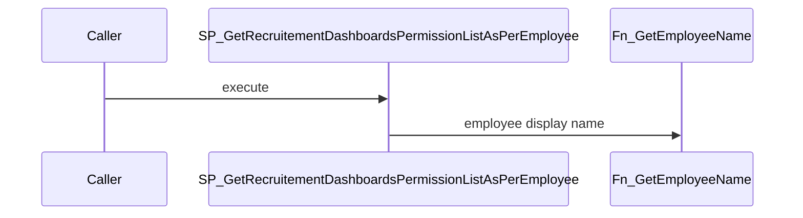
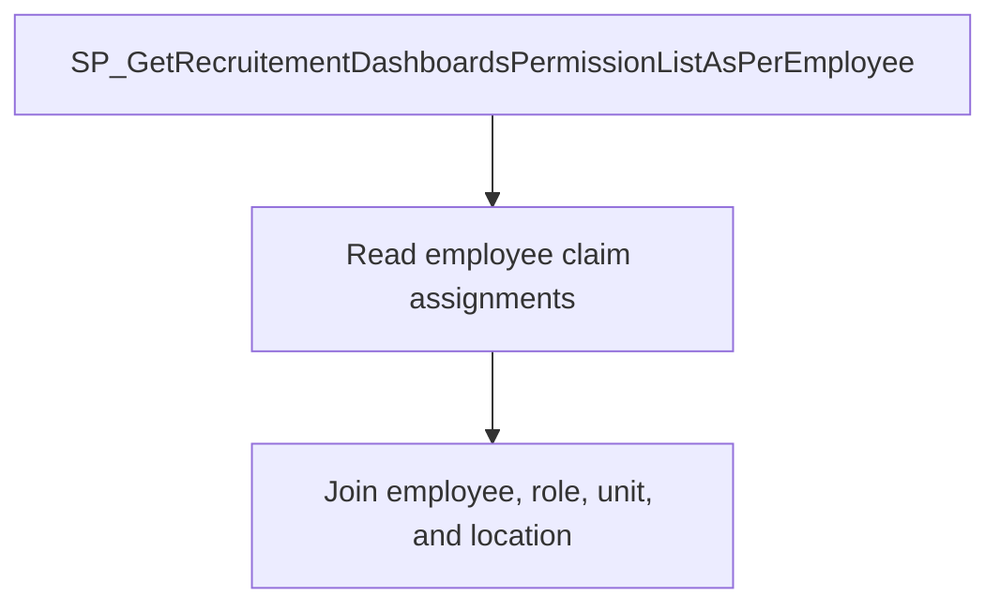

# SP_GetRecruitementDashboardsPermissionListAsPerEmployee

## What it does

Returns employee-level recruitment dashboard claim assignments for claims `TR001` and `TR002`, including the employee's business unit, location, role, and `CustomBU`.

## Parameters

| Name | Direction | What it is for |
|---|---|---|
| `@EmployerId` | in | Organisation |

## Call sequence

## Callers

No other procedure or function calls this object.

`recruitmentDAL.GetRecruitmentDashboardsUsersPermissionList` calls it from Recruitment Management.

## Nested

| Object | Kind | When | Page |
|---|---|---|---|
| `Fn_GetEmployeeName` | function | for each assigned employee | [Fn_GetEmployeeName](/docs/database/hrms/Fn_GetEmployeeName) |

## Steps

1. Select assignment id, employee, claim, custom business units, role, unit name, and location (`SP_GetRecruitementDashboardsPermissionListAsPerEmployee.sql`).
2. Join `TRecruitmentClaim` and keep short texts `TR001` and `TR002`.
3. Join `TEmployeeInfo` on employee and employer, then user, role, organisation unit, and location.
4. Filter to `@EmployerId`.

## Tables

| Table | Read or write |
|---|---|
| `TRecruitmentClaim_ASSIGNMENT` | read |
| `TRecruitmentClaim` | read |
| `TEmployeeInfo` | read |
| `TEmployerDetails` | read |
| `TUserEmployee` | read |
| `TUsers` | read |
| `TRoles` | read |
| `TOrgHierarchyDetails` | read |
| `TLocation` | read |

## Flow

