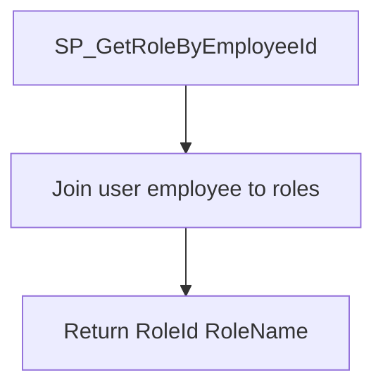

# SP_GetRoleByEmployeeId

## What it does

Returns the role id and role name for the user linked to an employee through `TUserEmployee` and `TUsers`. Charts Setup Employee Wise calls it after an employee is selected so the UI can compare that role against existing role-based chart permissions when filtering chart names.

## Parameters

| Name | Direction | What it is for |
|---|---|---|
| `@EmployeeId` | in | Employee whose linked user role is returned |

## Call sequence

Calls no other procedures or functions.

## Callers

No other procedure or function calls this object. App caller: `dashBoardDAL.GetRoleDetails` from Charts Setup Employee Wise (`SetupCharts.aspx`).

## Nested

Calls no other procedures or functions.

## Steps

In `HRMS-DATABASE/HRMS/STOREPROCEDURE/SP_GetRoleByEmployeeId.sql`:

1. Select `TR.RoleId` and `TR.RoleName` from `TUserEmployee` inner join `TUsers` on `UserId` inner join `TRoles` on `RoleId` where `TUserEmployee.EmployeeId = @EmployeeId`.

When the employee has no user mapping, the result set is empty.

## Tables

| Table | Read or write |
|---|---|
| `dbo.TUserEmployee` | read |
| `dbo.TUsers` | read |
| `dbo.TRoles` | read |

## Flow

