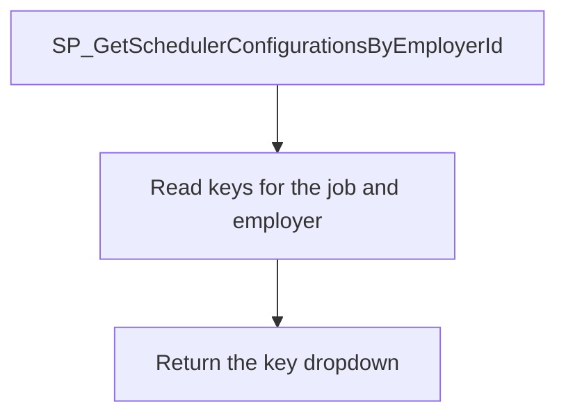

# SP_GetSchedulerConfigurationsByEmployerId

## What it does

Returns the configuration keys for one job and one employer. The configuration tab binds `ConfigId` as the value and `ConfigKey` as the text. `ConfigKeyDesc` is also selected.

## Parameters

| Name | Direction | What it is for |
|---|---|---|
| `@SchedulerName` | in | Job name |
| `@EmployerId` | in | Organisation |

## Call sequence

Calls no other procedures or functions.

## Callers

Procedures and functions that call this object.

No other procedure or function calls this object.

## Nested

Calls no other procedures or functions.

## Steps

1. In `HRMS-DATABASE/HRMS/STOREPROCEDURE/SP_GetSchedulerConfigurationsByEmployerId.sql`, select `ConfigId`, `ConfigKey`, and `ConfigKeyDesc` from `TJobSchedulerConfiguration` where `SchedulerName` equals `@SchedulerName` and `employerid` equals `@EmployerId`.

## Tables

| Table | Read or write |
|---|---|
| `TJobSchedulerConfiguration` | read |

## Flow

