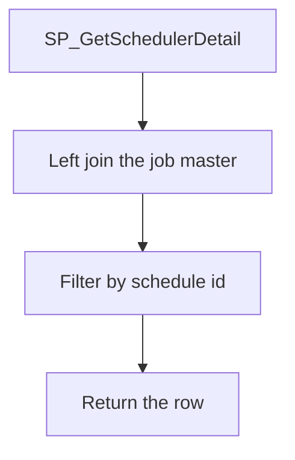

# SP_GetSchedulerDetail

## What it does

Returns one schedule for the pending-row edit form, including the job id, occurrence, time zone, times, type, and end-of-month flag. The job master is a left join, so a missing master still returns the schedule.

## Parameters

| Name | Direction | What it is for |
|---|---|---|
| `@SchedulerId` | in | `TSchedulers.Id` |

## Call sequence

Calls no other procedures or functions.

## Callers

Procedures and functions that call this object.

No other procedure or function calls this object.

## Nested

Calls no other procedures or functions.

## Steps

1. In `HRMS-DATABASE/HRMS/STOREPROCEDURE/SP_GetSchedulerDetail.sql`, select the schedule from `TSchedulers` and left join `TJobSchedulerMaster` on `SchedulerMasterId` = `SchedulerId`.

2. Derive `Occurrence` from the frequency bits. Include `TimeZoneID`, `ParameterValue`, `Type`, and `IsEndOfMonth`.

3. Filter `Id` = `@SchedulerId`.

## Tables

| Table | Read or write |
|---|---|
| `TSchedulers` | read |
| `TJobSchedulerMaster` | read |

## Flow

