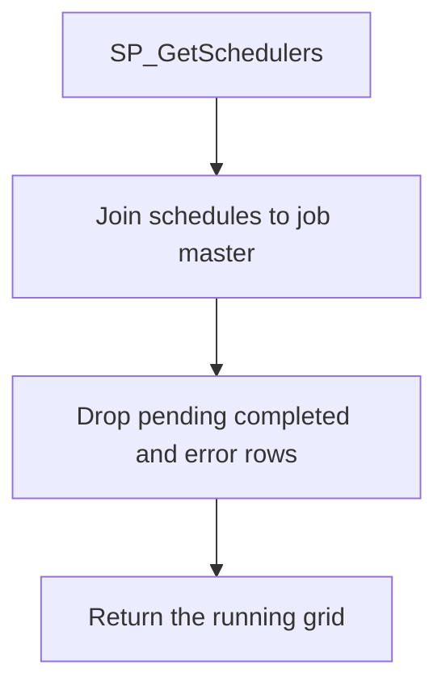

# SP_GetSchedulers

## What it does

Returns the Running Schedulers grid for one employer. It joins each schedule to its job name and keeps rows that are not pending, not completed, and not `RUN_WITH_ERRORS`, and whose error text is null or empty.

## Parameters

| Name | Direction | What it is for |
|---|---|---|
| `@EmployerId` | in | Organisation whose schedules are listed |

## Call sequence

Calls no other procedures or functions.

## Callers

Procedures and functions that call this object.

No other procedure or function calls this object.

## Nested

Calls no other procedures or functions.

## Steps

1. In `HRMS-DATABASE/HRMS/STOREPROCEDURE/SP_GetSchedulers.sql`, declare `@CURRENTDATE`. The date-window predicates that would use it are commented out.

2. Select schedule columns from `TSchedulers` joined to `TJobSchedulerMaster` on `SchedulerMasterId` = `SchedulerId`.

3. Derive `Occurrence` from the hourly, daily, weekly, monthly, and yearly bits. Format `StartTime` and `EndTime` as `varchar(5)` into `StartTimeCharValue` and `EndTimeCharValue`.

4. Keep rows for `@EmployerId` whose `Status` is not `PENDING`, `COMPLETED`, or `RUN_WITH_ERRORS`, and whose `Error` is null or empty. Order by `CreateDate` descending.

## Tables

| Table | Read or write |
|---|---|
| `TSchedulers` | read |
| `TJobSchedulerMaster` | read |

## Flow

