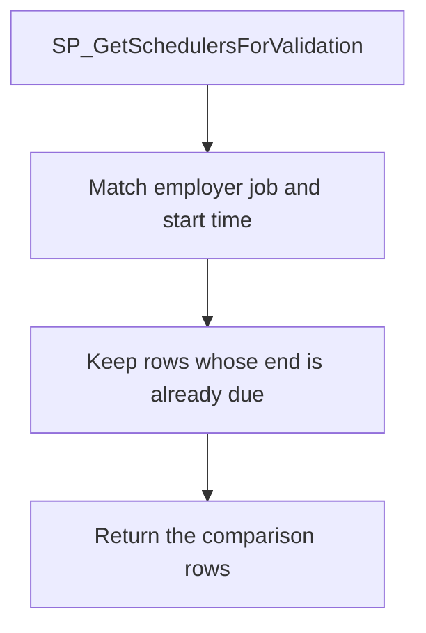

# SP_GetSchedulersForValidation

## What it does

Returns schedules for one employer and one job whose end date is already at or before the current time and whose start time equals the submitted start time. Manage Scheduler uses the rows to decide whether a submit clashes with an existing instance.

## Parameters

| Name | Direction | What it is for |
|---|---|---|
| `@EmployerId` | in | Organisation |
| `@SchedulerMasterId` | in | Job id |
| `@StartTime` | in | Start time text, converted to `time` |

## Call sequence

Calls no other procedures or functions.

## Callers

Procedures and functions that call this object.

No other procedure or function calls this object.

## Nested

Calls no other procedures or functions.

## Steps

1. In `HRMS-DATABASE/HRMS/STOREPROCEDURE/SP_GetSchedulersForValidation.sql`, set `@CURRENTDATE` to `GETDATE()`.

2. Select id, master id, employer, start and end dates, occurrence from the frequency bits, last executed, next execution, and start and end times from `TSchedulers`.

3. Keep rows for `@EmployerId` and `@SchedulerMasterId` where `@CURRENTDATE` is greater than or equal to `EndDate` and `StartTime` equals `CONVERT(time, @StartTime)`. Order by `CreateDate` descending.

## Tables

| Table | Read or write |
|---|---|
| `TSchedulers` | read |

## Flow

