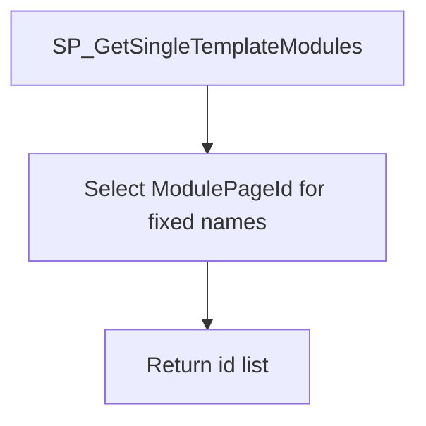

# SP_GetSingleTemplateModules

## What it does

Returns `ModulePageId` values from `TModulePages` for a fixed list of module page names that use a single email template (not workflow-bound). The list includes `EmployeeWelcomeMail`, which welcome-email preview relies on when matching templates without a workflow id.

## Parameters

| Name | Direction | What it is for |
|---|---|---|
| — | — | The procedure takes no parameters |

## Call sequence

Calls no other procedures or functions.

## Callers

| Object | Kind | Page |
|---|---|---|
| `SP_GetEmailTemplatesByFormName` | procedure | [SP_GetEmailTemplatesByFormName](/docs/database/hrms/SP_GetEmailTemplatesByFormName) |

## Nested

Calls no other procedures or functions.

## Steps

1. Select `ModulePageId` from `TModulePages` where `ModulePageName` is in the hard-coded single-template name list (includes `EmployeeWelcomeMail` and other notification modules).

## Tables

| Table | Read or write |
|---|---|
| `dbo.TModulePages` | read |

## Flow

