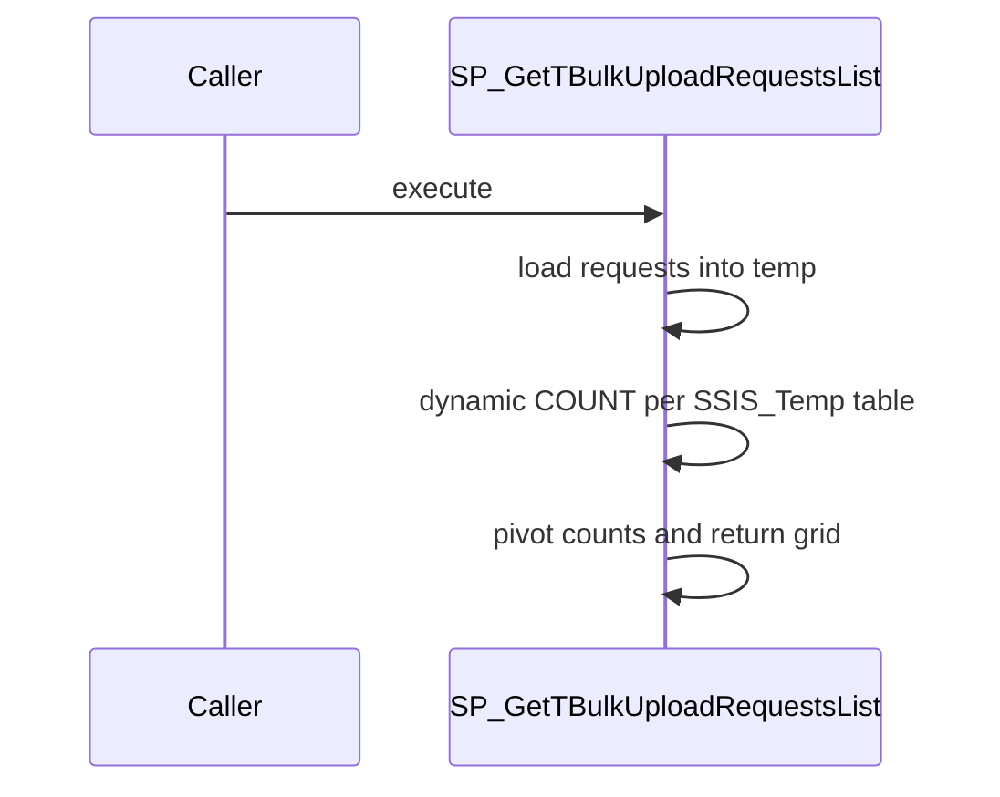
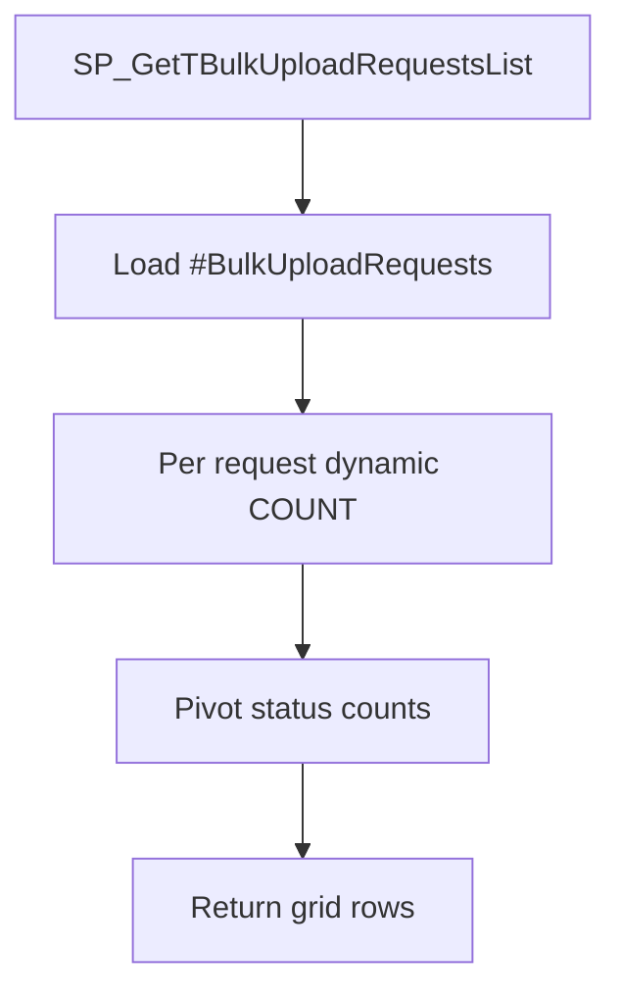

# SP_GetTBulkUploadRequestsList

## What it does

Returns the Client Onboarding Upload Files request grid for one employer. It loads active rows from `TBulkUploadRequests` joined to `TBulkUplaodTemplateMaster` for a fixed whitelist of `DBTempTableName` values, left-joins `TProcessBulkUploadRequest` for button state text, then dynamically counts Valid / Invalid / Success / Failed / Total rows in each request's `SSIS_Temp_*` staging table(s).

## Parameters

| Name | Direction | What it is for |
|---|---|---|
| `@EmployerId` | in | Organisation whose active upload requests are listed |

## Call sequence

Calls no other procedures or functions. Uses `STRING_SPLIT` and `EXEC (@NSQL)` for per-table counts.

## Callers

Procedures and functions that call this object.

No other procedure or function calls this object. App caller: `bulkUploadDAL.GetUploadRequestsList` from Upload Files (`UploadFiles.aspx`).

## Nested

| Object | Kind | When | Page |
|---|---|---|---|
| *(none)* | — | — | — |

## Steps

1. Script is `HRMS-DATABASE/HRMS/STOREPROCEDURE/SP_GetTBulkUploadRequestsList.sql`.
2. Select distinct active requests for `@EmployerId` into `#BulkUploadRequests`, joining template master and left-joining process rows; compute `ButtonName`, `ShowButton`, and `TextValue`.
3. Restrict to a hard-coded list of `DBTempTableName` values (calendar, employee, asset, TimePort, workflow, and other COB templates).
4. For each request, split comma-separated temp table names and run dynamic `COUNT` / `GROUPING SETS` against those tables filtered by `RequestId`.
5. Pivot Valid / Invalid / Success / Failed / Total into `#TablePivotData` and return the grid with percentages.

## Tables

| Table | Read or write |
|---|---|
| `dbo.TBulkUploadRequests` | read |
| `dbo.TBulkUplaodTemplateMaster` | read |
| `dbo.TProcessBulkUploadRequest` | read |
| `SSIS_Temp_*` (dynamic names from template master) | read |

## Unresolved calls

None.

## Flow

