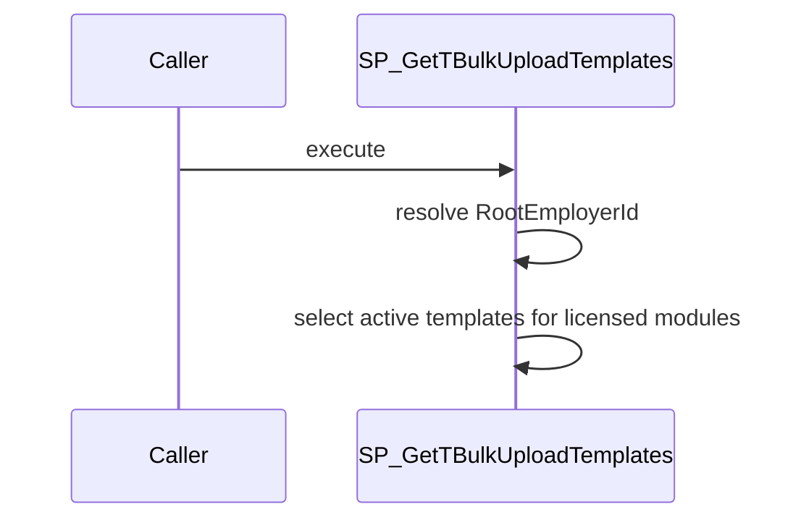
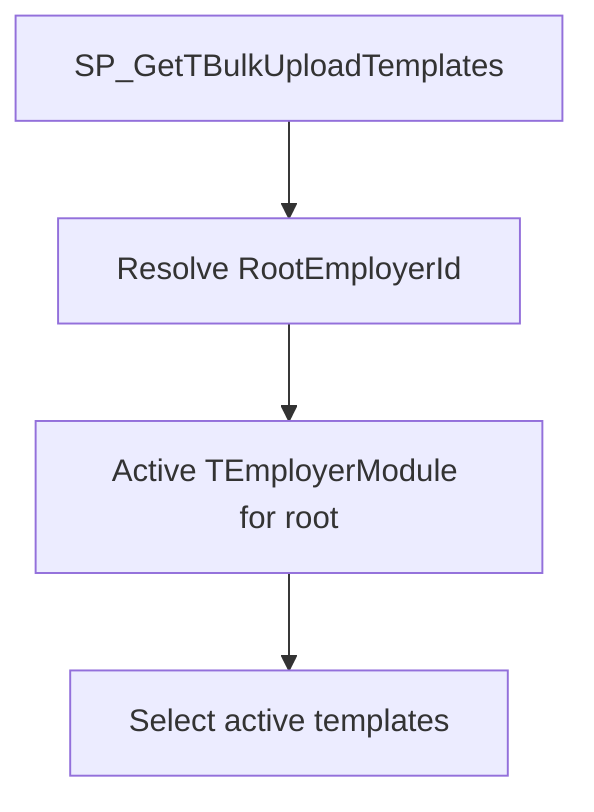

# SP_GetTBulkUploadTemplates

## What it does

Lists active Client Onboarding upload templates available for one organisation. It resolves the employer's `RootEmployerId`, then returns rows from `TBulkUplaodTemplateMaster` whose `ModuleID` is among the root's active `TEmployerModule` rows.

## Parameters

| Name | Direction | What it is for |
|---|---|---|
| `@EmployerId` | in | Organisation used to resolve the root and licensed modules |

## Call sequence

Calls no other procedures or functions.

## Callers

Procedures and functions that call this object.

No other procedure or function calls this object. App caller: `bulkUploadDAL.GetUploadTemplatesList` from Upload Files (`UploadFiles.aspx`).

## Nested

| Object | Kind | When | Page |
|---|---|---|---|
| *(none)* | — | — | — |

## Steps

1. Script is `HRMS-DATABASE/HRMS/STOREPROCEDURE/SP_GetTBulkUploadTemplates.sql` (file begins with `USE [HRM-CL-Prod]`).
2. Read `RootEmployerId` from `TEmployerDetails` for `@EmployerId`.
3. Select template columns from `TBulkUplaodTemplateMaster` where `IsActive = 1` and `ModuleID` is in active `TEmployerModule` rows for that root.

## Tables

| Table | Read or write |
|---|---|
| `dbo.TEmployerDetails` | read |
| `dbo.TEmployerModule` | read |
| `dbo.TBulkUplaodTemplateMaster` | read |

## Unresolved calls

None.

## Flow

