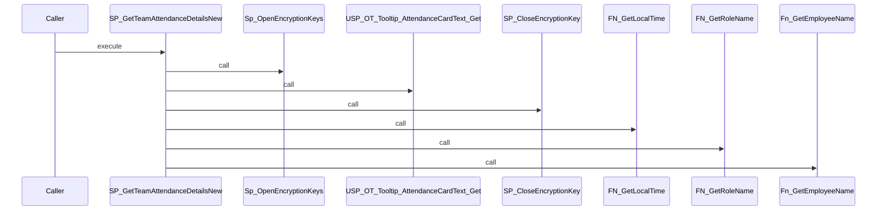
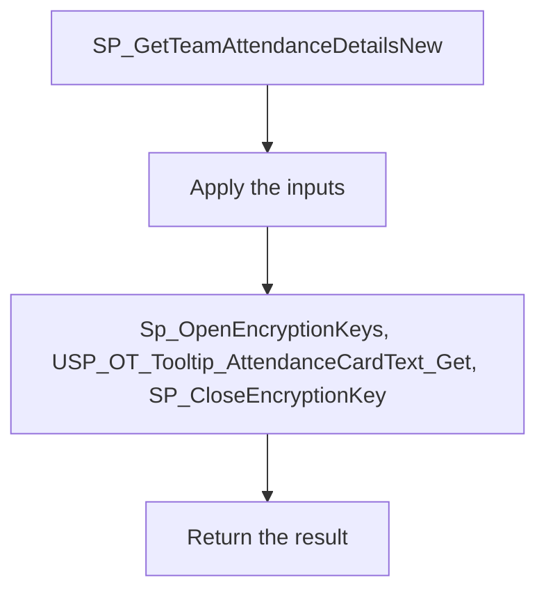

# SP_GetTeamAttendanceDetailsNew

## What it does

Returns a paged team attendance grid for the approver's My Team attendance view, for a date range, with the same day-status fields as the personal attendance card.

## Parameters

| Name | Direction | What it is for |
|---|---|---|
| `@Employeeid` | in | Employee the Home screen is loading or acting for (`INT`) |
| `@Employerid` | in | Employer that owns the data (`INT`) |
| `@StartDate` | in | Range start (`DATE`) |
| `@EndDate` | in | Range end (`DATE`) |
| `@EmployeeIds` | in | Input used by this procedure (`VARCHAR(2000)`) |
| `@EmployeeName` | in | Optional name filter. Empty means do not filter by name (`VARCHAR(100)`) |
| `@PageNumber` | in | Page number for the list. Empty uses the procedure default (`INT`) |
| `@PageSize` | in | Page size for the list. Empty uses the procedure default (`INT`) |
| `@ViewType` | in | Input used by this procedure (`VARCHAR(MAX)`) |

## Call sequence

## Callers

No other procedure or function under STOREPROCEDURE or FUNCTIONS executes this object.

## Nested

| Object | Kind | When | Page |
|---|---|---|---|
| `Sp_OpenEncryptionKeys` | procedure | Called while this object runs | [Sp_OpenEncryptionKeys](/docs/database/hrms/Sp_OpenEncryptionKeys) |
| `USP_OT_Tooltip_AttendanceCardText_Get` | procedure | Called while this object runs | [USP_OT_Tooltip_AttendanceCardText_Get](/docs/database/hrms/USP_OT_Tooltip_AttendanceCardText_Get) |
| `SP_CloseEncryptionKey` | procedure | Called while this object runs | [SP_CloseEncryptionKey](/docs/database/hrms/SP_CloseEncryptionKey) |
| `FN_GetLocalTime` | function | Called while this object runs | [FN_GetLocalTime](/docs/database/hrms/FN_GetLocalTime) |
| `FN_GetRoleName` | function | Called while this object runs | [FN_GetRoleName](/docs/database/hrms/FN_GetRoleName) |
| `Fn_GetEmployeeName` | function | Called while this object runs | [Fn_GetEmployeeName](/docs/database/hrms/Fn_GetEmployeeName) |
| `Fn_DirectIndirectReportee` | function | Called while this object runs | [Fn_DirectIndirectReportee](/docs/database/hrms/Fn_DirectIndirectReportee) |
| `FN_LocationBU_GetEmployeeDetails` | function | Called while this object runs | [FN_LocationBU_GetEmployeeDetails](/docs/database/hrms/FN_LocationBU_GetEmployeeDetails) |
| `UFN_FormatDateTimeStandard` | function | Called while this object runs | [UFN_FormatDateTimeStandard](/docs/database/hrms/UFN_FormatDateTimeStandard) |
| `FN_ConvertMinutesToHHMM` | function | Called while this object runs | [FN_ConvertMinutesToHHMM](/docs/database/hrms/FN_ConvertMinutesToHHMM) |
| `FN_Get_EmployeeActualWorkedMinute` | function | Called while this object runs | [FN_Get_EmployeeActualWorkedMinute](/docs/database/hrms/FN_Get_EmployeeActualWorkedMinute) |
| `FN_Get_EmployeeWorkedMinute` | function | Called while this object runs | [FN_Get_EmployeeWorkedMinute](/docs/database/hrms/FN_Get_EmployeeWorkedMinute) |

## Steps

In `HRMS-DATABASE/HRMS/STOREPROCEDURE/SP_GetTeamAttendanceDetailsNew.sql`:

1. Returns a paged team attendance grid for the approver's My Team attendance view, for a date range, with the same day-status fields as the personal attendance card.

## Tables

| Table | Read or write |
|---|---|
| `TEmployeeInfo` | read |
| `TUsers` | read |
| `TUserEmployee` | read |
| `tEmployee` | read |
| `TLeaveRequestDays` | read |
| `TLeaveRequest` | read |
| `tLeaveTypeMaster` | read |
| `TAttendanceRegularizationDays` | read |
| `TCalenderDays` | read |
| `TEmployeeRoasterDetails` | read |
| `TShiftGroupMaster` | read |
| `TSHIFTMASTER` | read |
| `TRequestWorkflows` | read |
| `TOptionalHolidayRequest` | read |
| `TAttendanceRegularization` | read |
| `TAttendanceRegularizeCategory` | read |
| `THolidayMaster` | read |
| `TDailyRegisterNew` | read |
| `TEmployerDetails` | read |
| `TCustomerSettings` | read |
| `TShiftAttendanceConfig` | read |
| `TAttendanceTransaction` | read |
| `TWorkfromHomeRequestDays` | read |
| `TWorkfromHomeRequest` | read |

## Flow

