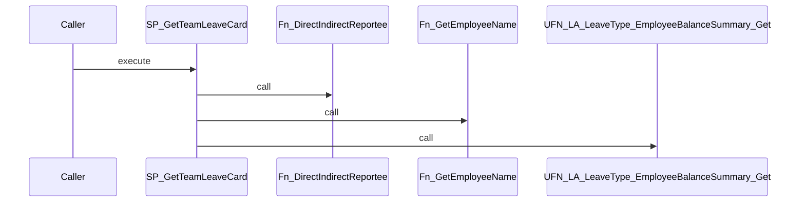
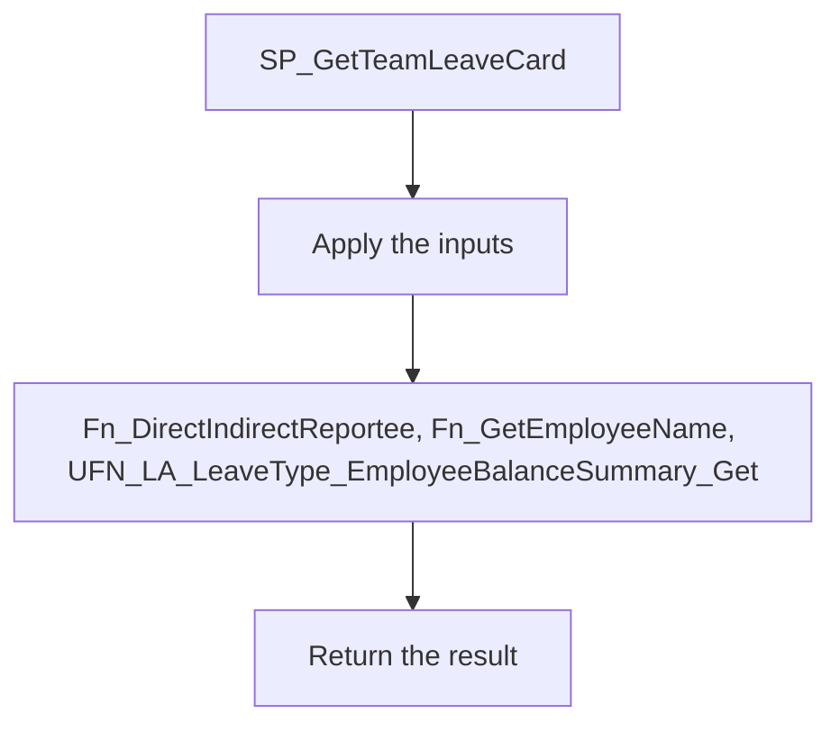

# SP_GetTeamLeaveCard

## What it does

Returns the approver's team leave card for a date range: which reportees are on leave, and their leave-type balances.

## Parameters

| Name | Direction | What it is for |
|---|---|---|
| `@Employeeid` | in | Employee the Home screen is loading or acting for (`INT`) |
| `@StartDate` | in | Range start (`DATE`) |
| `@EndDate` | in | Range end (`DATE`) |

## Call sequence

## Callers

No other procedure or function under STOREPROCEDURE or FUNCTIONS executes this object.

## Nested

| Object | Kind | When | Page |
|---|---|---|---|
| `Fn_DirectIndirectReportee` | function | Called while this object runs | [Fn_DirectIndirectReportee](/docs/database/hrms/Fn_DirectIndirectReportee) |
| `Fn_GetEmployeeName` | function | Called while this object runs | [Fn_GetEmployeeName](/docs/database/hrms/Fn_GetEmployeeName) |
| `UFN_LA_LeaveType_EmployeeBalanceSummary_Get` | function | Called while this object runs | [UFN_LA_LeaveType_EmployeeBalanceSummary_Get](/docs/database/hrms/UFN_LA_LeaveType_EmployeeBalanceSummary_Get) |

## Steps

In `HRMS-DATABASE/HRMS/STOREPROCEDURE/SP_GetTeamLeaveCard.sql`:

1. Returns the approver's team leave card for a date range: which reportees are on leave, and their leave-type balances.

## Tables

| Table | Read or write |
|---|---|
| `TEmployee` | read |
| `TUserEmployee` | read |
| `TUsers` | read |
| `TEmployeeInfo` | read |
| `TleaveRequestdays` | read |
| `tLeaveTypeMaster` | read |

## Flow

