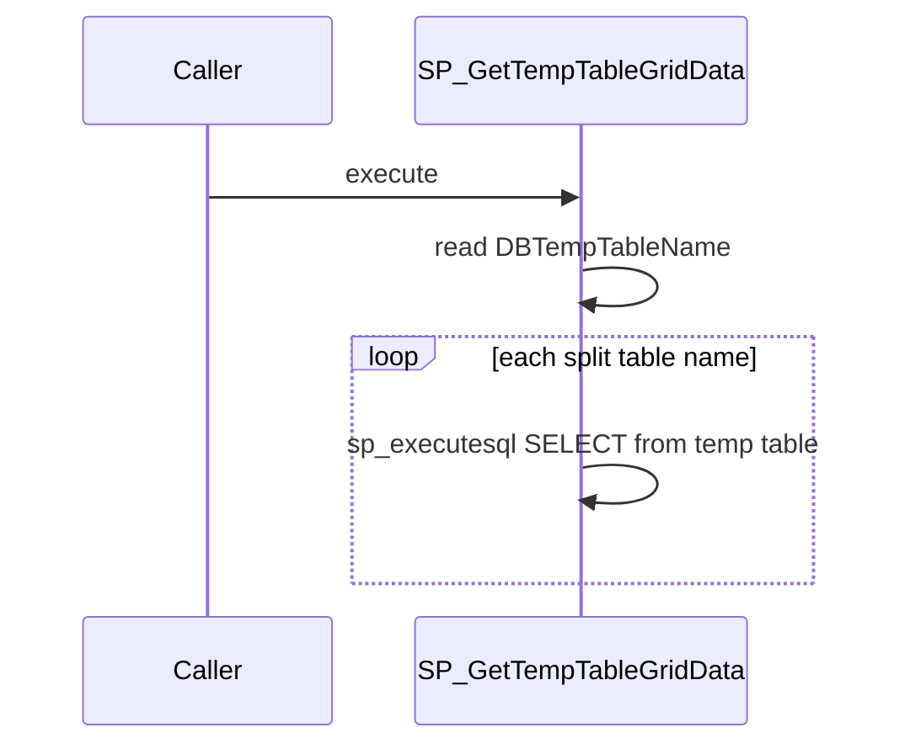
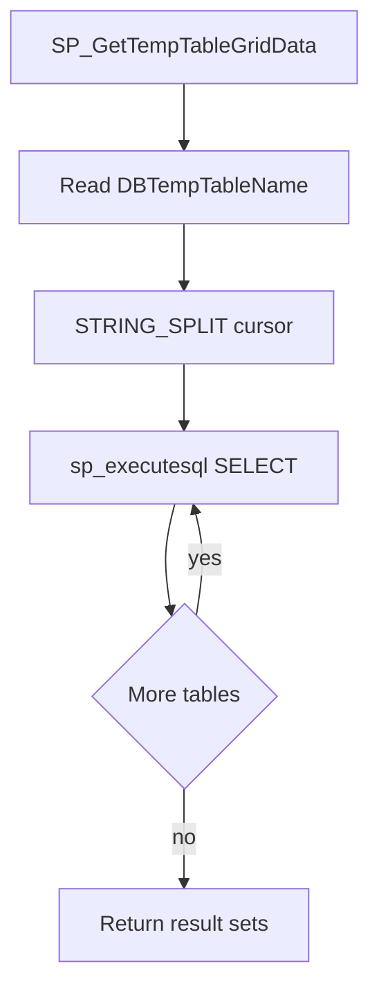

# SP_GetTempTableGridData

## What it does

Returns unprocessed staging rows for one Client Onboarding upload request and template. It reads `DBTempTableName` from `TBulkUplaodTemplateMaster`, splits comma-separated names, and for each name runs a dynamic `SELECT *, ColorClass` from that table where `RequestId` matches and `IsProcess = 0`. Multiple result sets are returned when a template maps to several temp tables.

## Parameters

| Name | Direction | What it is for |
|---|---|---|
| `@RequestId` | in | Upload request id on staging rows |
| `@UploadTemplateId` | in | Template whose `DBTempTableName` list is opened |

## Call sequence

Uses system `sp_executesql` only. Calls no other user procedures.

## Callers

Procedures and functions that call this object.

No other procedure or function calls this object. App caller: `bulkUploadDAL.GetTempTablesData` from Upload Files per-template grid components.

## Nested

| Object | Kind | When | Page |
|---|---|---|---|
| *(none)* | — | dynamic SQL only | — |

## Steps

1. Script is `HRMS-DATABASE/HRMS/STOREPROCEDURE/SP_GetTempTableGridData.sql`.
2. Open a cursor over `STRING_SPLIT` of `TBulkUplaodTemplateMaster.DBTempTableName` for `@UploadTemplateId`.
3. For each table name, build and execute `SELECT *, CASE WHEN ProcessStatus = 'Invalid' THEN 'redClass' ELSE '' END AS ColorClass FROM <table> WHERE RequestId = @RequestId AND IsProcess = 0`.

## Tables

| Table | Read or write |
|---|---|
| `dbo.TBulkUplaodTemplateMaster` | read |
| `SSIS_Temp_*` (dynamic names from template master) | read |

## Unresolved calls

None beyond system `sp_executesql`.

## Flow

