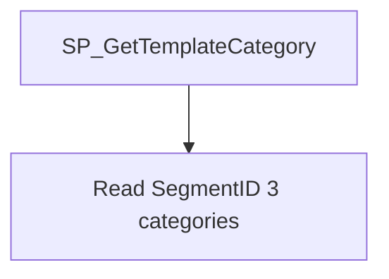

# SP_GetTemplateCategory

## What it does

Returns active employee-detail categories with `SegmentID` 3 for the template-category dropdown. `@EmployerID` is accepted and unused in the select.

## Parameters

| Name | Direction | What it is for |
|---|---|---|
| `@EmployerID` | in | Accepted by the signature; not used in the query |

## Call sequence

Calls no other procedures or functions.

## Callers

No other procedure or function calls this object.

## Nested

Calls no other procedures or functions.

## Steps

1. Select category id as `TCategoryID`, name, active flag, and audit columns from `Temployeedetail_category` where `IsActive` is 1 and `SegmentID` is 3.

## Tables

| Table | Read or write |
|---|---|
| `Temployeedetail_category` | read |

## Flow

