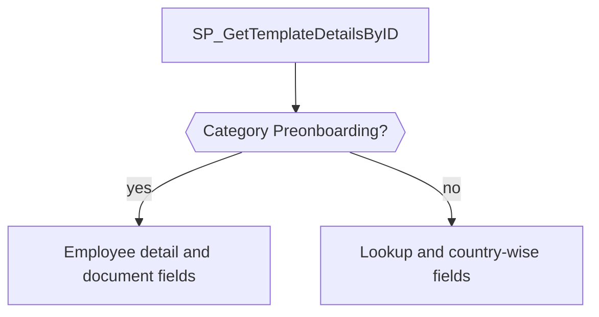

# SP_GetTemplateDetailsByID

## What it does

Returns the configured fields for one active template. When the template category is Preonboarding, it reads employee-detail fields and document-category mappings. Otherwise it returns lookup and country-wise field data.

## Parameters

| Name | Direction | What it is for |
|---|---|---|
| `@EmployerId` | in | Employer of the template |
| `@TemplateId` | in | Template to open |

## Call sequence

Calls no other procedures or functions.

## Callers

No other procedure or function calls this object.

## Nested

Calls no other procedures or functions.

## Steps

1. Resolve the category name from `POBTemplate` and `TemployeeDetail_category`.
2. When the category is Preonboarding, return unions of active `POBTemplateFields` joined to employee-detail sections and fields, passport or visa fields, and POB document-category mappings.
3. Otherwise return lookup-data and country-wise-field-data unions against `POBLookupEmployerMapping` and `TCountryWiseFieldName`.

## Tables

| Table | Read or write |
|---|---|
| `POBTemplate` | read |
| `TemployeeDetail_category` | read |
| `POBTemplateFields` | read |
| `TemployeeDetail_Section` | read |
| `temployeedetail_fields` | read |
| `TFieldType_LookUp` | read |
| `POBLookupEmployerMapping` | read |
| `POBLookupITEMS` | read |
| `POBLookupMaster` | read |
| `TCountryWiseFieldName` | read |

## Flow

