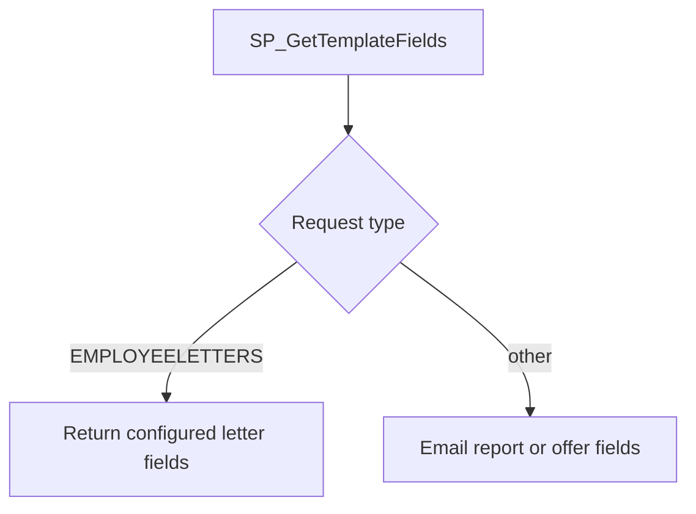

# SP_GetTemplateFields

## What it does

Returns placeholder fields for a form. Setup Employee Self Service always calls the EMPLOYEELETTERS branch. That branch unions employer field configuration with fields that have no employee-detail field name. The same procedure also has EMAIL, REPORTS, and OFFERDOCUMENT branches for other callers.

## Parameters

| Name | Direction | What it is for |
|---|---|---|
| `@RequestType` | in | EMAIL, REPORTS, OFFERDOCUMENT, or EMPLOYEELETTERS |
| `@FormName` | in | Form key. This screen passes EMPLOYEELETTERS |
| `@FieldCategory` | in | This screen passes N |
| `@Employerid` | in | Employer used to filter configured fields and country |

## Call sequence

Calls no other procedures or functions.

## Callers

No other procedure or function calls this object.

## Nested

Calls no other procedures or functions.

## Steps

1. Read the employer country, manual-approval setting, and whether a Replacement hiring reason is shown (`SP_GetTemplateFields.sql`).
2. When `@RequestType` is EMPLOYEELETTERS, select active visible `TFields` joined to `temployeedetail_fields` for the employer, union the same shape from `temployeedetail_fields_master` when the employer id is 0, and union `TFields` rows whose employee-detail field name is empty.
3. Other request types select a different field list and are not the path this screen uses.

## Tables

| Table | Read or write |
|---|---|
| `dbo.TEmployerDetails` | read |
| `dbo.TCustomerSettings` | read |
| `dbo.THiringReason` | read |
| `dbo.TFields` | read |
| `dbo.temployeedetail_fields` | read |
| `dbo.temployeedetail_fields_master` | read |

## Flow

