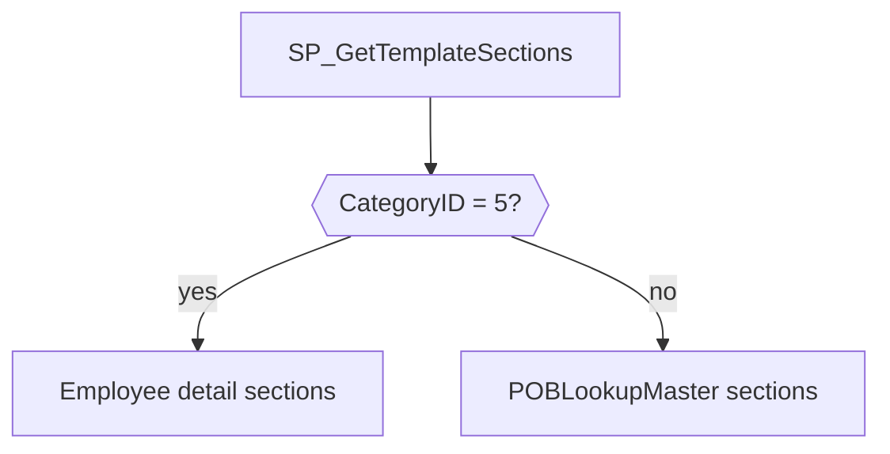

# SP_GetTemplateSections

## What it does

Returns the section checklist for a template category. Category 5 uses employee-detail sections. Other categories map through `POBTemplateCategory` to `POBLookupMaster` sections.

## Parameters

| Name | Direction | What it is for |
|---|---|---|
| `@EmployerID` | in | Employer used when resolving non-5 categories |
| `@CategoryID` | in | Template category id |

## Call sequence

Calls no other procedures or functions.

## Callers

No other procedure or function calls this object.

## Nested

Calls no other procedures or functions.

## Steps

1. When `@CategoryID` is 5, return active sections from `TEmployeeDetail_Section` joined to `TEmployeedetail_section_category`, merging Passport and Visa into Passport Visa Details and excluding Nomination Details.
2. Otherwise resolve `@TCategoryID` from `POBTemplateCategory` and `temployeedetail_category`, then return active `POBLookupMaster` rows for that template category.

## Tables

| Table | Read or write |
|---|---|
| `TEmployeeDetail_Section` | read |
| `TEmployeedetail_section_category` | read |
| `POBTemplateCategory` | read |
| `temployeedetail_category` | read |
| `POBLookupMaster` | read |

## Flow

