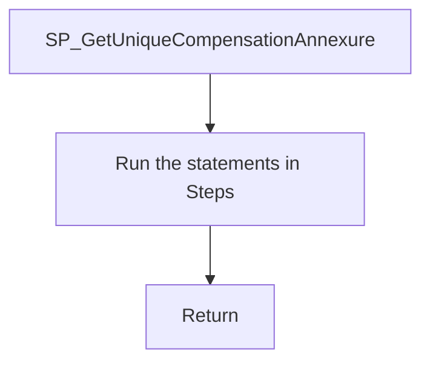

# SP_GetUniqueCompensationAnnexure

## What it does

Returns a pivoted annexure/component listing including validated-component flags for the Create Structure UI.

## Parameters

| Name | Direction | What it is for |
|---|---|---|
| `@employerId` | in | Employer |

## Call sequence

Calls no other procedures or functions.

## Callers

No other procedure or function calls this object.

## Nested

Calls no other procedures or functions.

## Steps

1. Build #ValidValues from ValidatedComponentIds CSV on CompensationAnnexure.
2. Select distinct annexure and component display rows joined to structure and earning components.
3. Include ComponentIDValidValue from the validated set.

## Tables

| Table | Read or write |
|---|---|
| `dbo.CompensationAnnexure` | read |
| `dbo.TCompensationStructure` | read |
| `dbo.TEarningSalaryComponents` | read |

## Flow

