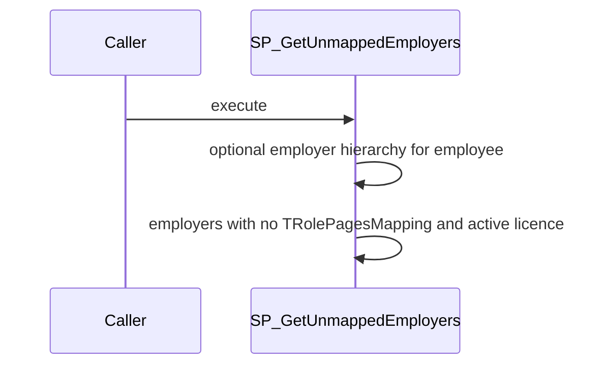
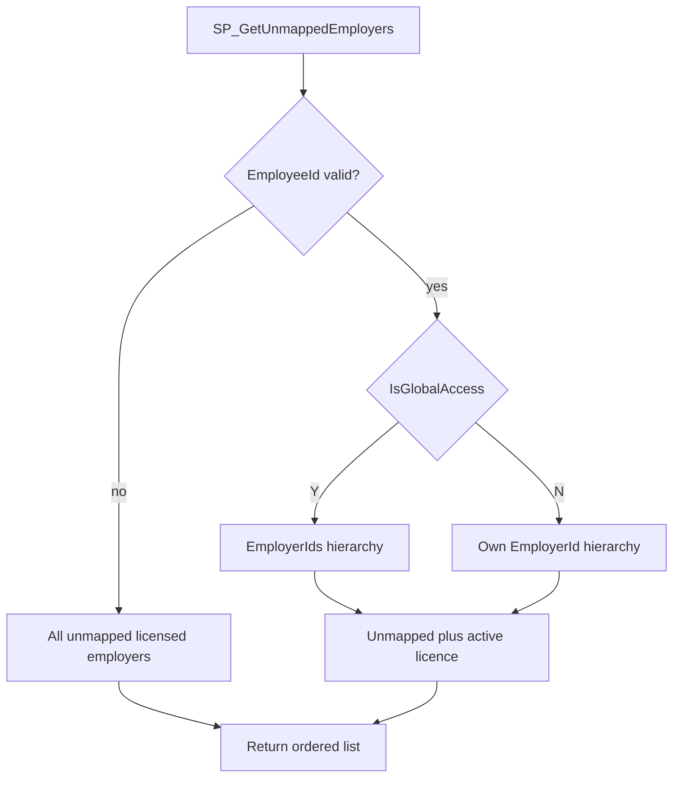

# SP_GetUnmappedEmployers

## What it does

Lists active, non-deleted employers that have **no** rows in `TRolePagesMapping` and whose root organisation has an **Active** (non-soft-deleted) licence. Used by Default Access Right Management as the employer picker for organisations that still need access rights published.

When `@EmployeeId` is null or ≤ 0, the list is unscoped (all such employers). Otherwise it restricts to the caller’s accessible employer tree: global-access users expand from comma-separated `TUsers.EmployerIds`; others expand from their own `TUsers.EmployerId` down through children.

## Parameters

| Name | Direction | What it is for |
|---|---|---|
| `@EmployeeId` | in | Caller employee id for access scoping. ≤ 0 means no scope filter |

## Call sequence

Calls no other procedures or functions.

## Callers

Procedures and functions that call this object.

No other procedure or function calls this object. Application caller: Core Node `AccessRightsManagementDAL.getEmployersWithoutAccessRights` via `GET /api/accessRightsManagement/employersWithoutAccessRights`.

## Nested

Calls no other procedures or functions.

## Steps

1. `SET NOCOUNT ON`.

2. If `@EmployeeId` ≤ 0: select from `TEmployerDetails` left-anti-joined to distinct `TRolePagesMapping.EmployerId`, requiring active/non-deleted employer and an active `TLicence` on `ISNULL(NULLIF(RootEmployerId,0), EmployerId)`. Return name, id, parent, customer code, `IsParentOrg`.

3. Else if the employee’s user has `IsGlobalAccess = 'Y'`: build `@EmployerAccess` from employers in `TUsers.EmployerIds` plus descendants; else seed from the user’s `EmployerId` plus descendants.

4. Select the same unmapped + licensed employers restricted to `@EmployerAccess`, ordered by `EmployerName`.

## Tables

| Table | Read or write |
|---|---|
| `TEmployerDetails` | read |
| `TRolePagesMapping` | read |
| `TLicence` | read |
| `TUsers` | read |
| `TUserEmployee` | read |

## Unresolved calls

None.

## Flow

