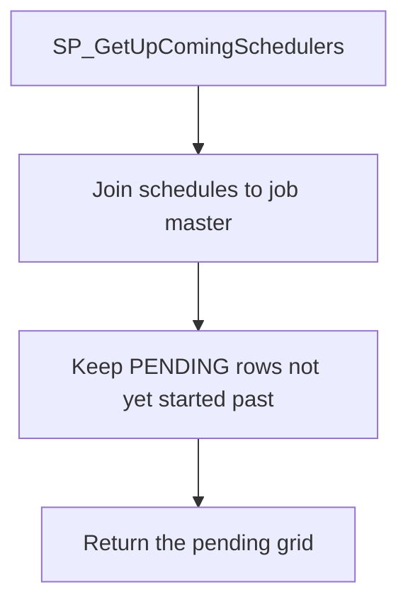

# SP_GetUpComingSchedulers

## What it does

Returns the Pending Scheduler grid. It lists `PENDING` rows for one employer whose start and end dates are today or later. The constant `SP_GetUpcomingSchedulers` in `DBConstant.cs` is this procedure name. The result does not include `StartTimeCharValue` or `EndTimeCharValue`.

## Parameters

| Name | Direction | What it is for |
|---|---|---|
| `@EmployerId` | in | Organisation whose pending schedules are listed |

## Call sequence

Calls no other procedures or functions.

## Callers

Procedures and functions that call this object.

No other procedure or function calls this object.

## Nested

Calls no other procedures or functions.

## Steps

1. In `HRMS-DATABASE/HRMS/STOREPROCEDURE/SP_GetUpComingSchedulers.sql`, set `@CURRENTDATE` to `GETDATE()`.

2. Select schedule columns from `TSchedulers` joined to `TJobSchedulerMaster` on `SchedulerMasterId` = `SchedulerId`. Derive `Occurrence` from the frequency bits. Return `StartTime` and `EndTime` as time values.

3. Keep rows for `@EmployerId` with `Status` = `PENDING`, where the start date is today or in the future and the end date is today or in the future. Time-of-day comparisons in that filter are commented out. Order by `CreateDate` descending.

## Tables

| Table | Read or write |
|---|---|
| `TSchedulers` | read |
| `TJobSchedulerMaster` | read |

## Flow

