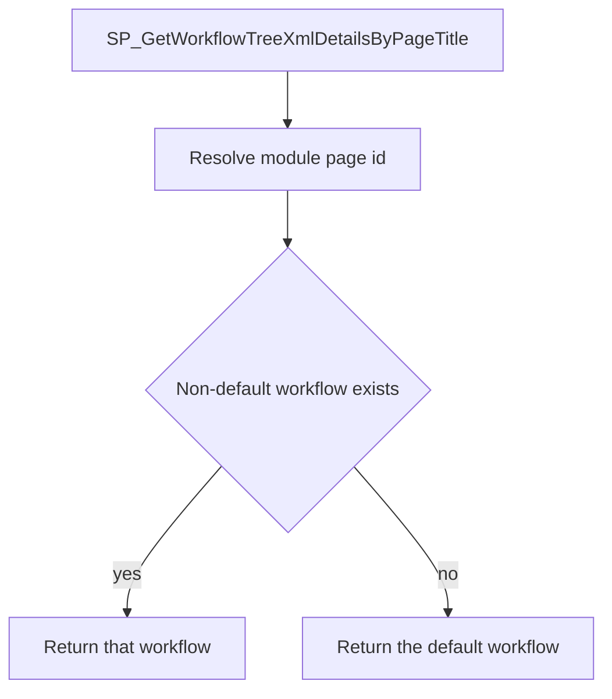

# SP_GetWorkflowTreeXmlDetailsByPageTitle

## What it does

Returns the workflow id and definition tree for one module page and employer. It prefers an enabled, non-default workflow whose mapped pages include that page. When none exists, it returns the enabled default workflow for the same page.

## Parameters

| Name | Direction | What it is for |
|---|---|---|
| `@PageTitle` | in | `TModulePages.ModulePageName` |
| `@Employerid` | in | Organisation |

Both are inputs. The result is `WorkflowId` and `WorkflowDefinitionTree`.

## Call sequence

Calls no other procedures or functions.

## Callers

| Object | Kind | Page |
|---|---|---|
| `SP_AddCalendarMaster` | procedure | No page yet |
| `SP_AddCategory` | procedure | No page yet |
| `SP_AddNewBankBranch` | procedure | No page yet |
| `SP_AddNewBankName` | procedure | No page yet |
| `SP_AddResignation` | procedure | No page yet |
| `SP_AddTitle` | procedure | No page yet |
| `SP_AdminMstr_AddBGVCategory` | procedure | No page yet |
| `SP_AdminMstr_AddCalendar` | procedure | [SP_AdminMstr_AddCalendar](/docs/database/hrms/SP_AdminMstr_AddCalendar) |
| `SP_AdminMstr_AddCategory` | procedure | No page yet |
| `SP_AdminMstr_AddNewBank` | procedure | [SP_AdminMstr_AddNewBank](/docs/database/hrms/SP_AdminMstr_AddNewBank) |
| `SP_AdminMstr_AddNewBranch` | procedure | No page yet |
| `SP_AdminMstr_AddResignation` | procedure | No page yet |
| `SP_AdminMstr_AddTitle` | procedure | [SP_AdminMstr_AddTitle](/docs/database/hrms/SP_AdminMstr_AddTitle) |
| `SP_AdminMstr_UpdBank` | procedure | No page yet |
| `SP_AdminMstr_UpdBankBranch` | procedure | No page yet |
| `SP_AdminMstr_UpdBGVCategory` | procedure | No page yet |
| `SP_AdminMstr_UpdCalendar` | procedure | [SP_AdminMstr_UpdCalendar](/docs/database/hrms/SP_AdminMstr_UpdCalendar) |
| `SP_AdminMstr_UpdCategory` | procedure | No page yet |
| `SP_AdminMstr_UpdResignationType` | procedure | No page yet |
| `SP_AdminMstr_UpdTitle` | procedure | No page yet |
| `SP_AdminRoleM_InsRoles` | procedure | No page yet |
| `SP_AdminRoleM_UpdRoles` | procedure | No page yet |
| `SP_CM_RequestReRoute` | procedure | No page yet |
| `SP_CM_RequestReRouteBKP03052025` | procedure | No page yet |
| `Sp_EC_SentBirthdayWorkAnnNotification` | procedure | No page yet |
| `SP_InsertRoles` | procedure | No page yet |
| `SP_ResignationPullback` | procedure | No page yet |
| `SP_UpdateBankBranch` | procedure | No page yet |
| `SP_UpdateBankName` | procedure | No page yet |
| `SP_UpdateCalendarMaster` | procedure | No page yet |
| `SP_UpdateCategory` | procedure | No page yet |
| `SP_UpdateResignationType` | procedure | No page yet |
| `SP_UpdateTitle` | procedure | No page yet |
| `USP_Reassign_Execute` | procedure | No page yet |
| `USP_Reassign_Save` | procedure | No page yet |

## Nested

Calls no other procedures or functions.

## Steps

1. Read `ModulePageId` from `TModulePages` for `@PageTitle` (`SP_GetWorkflowTreeXmlDetailsByPageTitle.sql`).
2. Count enabled, non-deleted, non-default workflows for `@Employerid` whose `MappedPages` equals that id or contains it in a comma list, and that have a `TWorkflowDetails` row.
3. When the count is greater than zero, return those workflows' `WorkflowId` and `WorkflowDefinitionTree`.
4. Otherwise return the same columns for the enabled default workflow (`isdefault = 1`) that matches the page.

## Tables

| Table | Read or write |
|---|---|
| `TModulePages` | read |
| `TWorkflowManagement` | read |
| `TWorkflowDetails` | read |

## Flow

