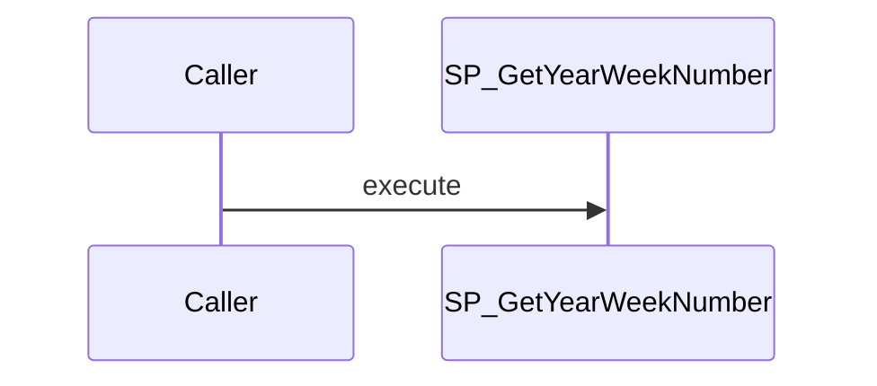
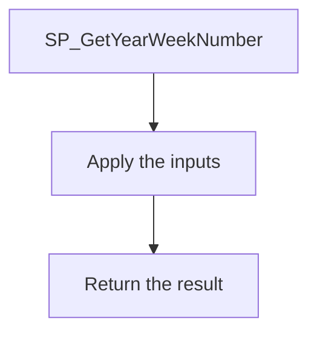

# SP_GetYearWeekNumber

## What it does

Called from the Home dashboard path. It reads tEmployerDetails, TAttendanceCalendarMasterData and returns the result to its caller.

## Parameters

| Name | Direction | What it is for |
|---|---|---|
| `@Date` | in | Input used by this procedure (`Date`) |
| `@EmployerID` | in | Employer that owns the data (`INT`) |
| `@YearWeekNumber` | out | Input used by this procedure (`INT`) |
| `@FirstDateOfWeek` | out | Input used by this procedure (`DATE`) |
| `@LastDateOfWeek` | out | Input used by this procedure (`DATE`) |

## Call sequence

## Callers

| Object | Kind | Page |
|---|---|---|
| `SP_DB_EmployeeAttendanceDetails` | procedure | [SP_DB_EmployeeAttendanceDetails](/docs/database/hrms/SP_DB_EmployeeAttendanceDetails) |
| `SP_DB_EmployeeAttendanceDetails_HT` | procedure | No page yet |
| `SP_DB_EmployeeAttendanceFromEmailDetails` | procedure | No page yet |
| `Sp_GetEmpAttendanceDetails` | procedure | No page yet |
| `Sp_GetEmpAttendanceDetailsScheduler` | procedure | No page yet |
| `SP_GetHomePageTimeDetails` | procedure | No page yet |
| `SP_GetHomePageTimeDetails_latest` | procedure | No page yet |
| `SP_GetHomePageWeeklyTotalHrs` | procedure | No page yet |
| `SP_Insert_TDailyRegisterNew` | procedure | No page yet |
| `SP_UpdateWeeklyAttendanceStatus` | procedure | No page yet |
| `USP_CalculateDailyAttendance` | procedure | No page yet |
| `USP_GET_RPI_AttendenceNotificationCount_1182024` | procedure | No page yet |

## Nested

This object does not execute another procedure or user-defined function.

## Steps

In `HRMS-DATABASE/HRMS/STOREPROCEDURE/SP_GetYearWeekNumber.sql`:

1. Read `tEmployerDetails`, `TAttendanceCalendarMasterData`.
2. Return the result set to the caller.

## Tables

| Table | Read or write |
|---|---|
| `tEmployerDetails` | read |
| `TAttendanceCalendarMasterData` | read |

## Flow

