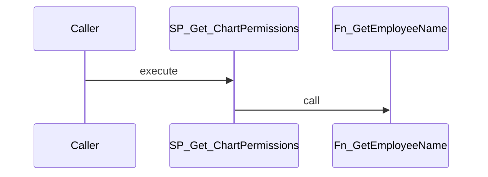
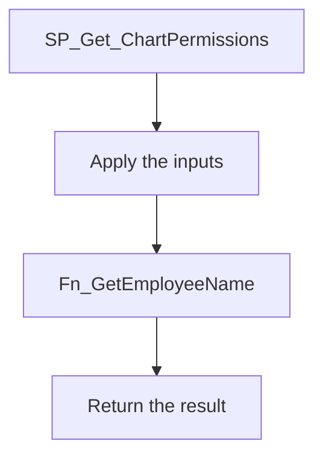

# SP_Get_ChartPermissions

## What it does

Returns the chart-permission grid the management dashboard uses to decide which charts this employee or role may see.

## Parameters

| Name | Direction | What it is for |
|---|---|---|
| `@EmployerId` | in | Employer that owns the data (`INT`) |
| `@ModuleId` | in | Chart module. The Home management toggle passes 0 (`INT`) |
| `@ChartPermissionsIds` | in | Input used by this procedure (`VARCHAR(1000)`) |
| `@EmployerIds` | in | Comma-separated employer ids in the chart filter (`VARCHAR(MAX)`) |

## Call sequence

## Callers

No other procedure or function under STOREPROCEDURE or FUNCTIONS executes this object.

## Nested

| Object | Kind | When | Page |
|---|---|---|---|
| `Fn_GetEmployeeName` | function | Called while this object runs | [Fn_GetEmployeeName](/docs/database/hrms/Fn_GetEmployeeName) |

## Steps

In `HRMS-DATABASE/HRMS/STOREPROCEDURE/SP_Get_ChartPermissions.sql`:

1. Returns the chart-permission grid the management dashboard uses to decide which charts this employee or role may see.

## Tables

| Table | Read or write |
|---|---|
| `tChartPermissions` | read |
| `TCharts` | read |
| `TChartDashboards` | read |
| `temployerdetails` | read |
| `tHRMSModules` | read |
| `tRoles` | read |

## Flow

