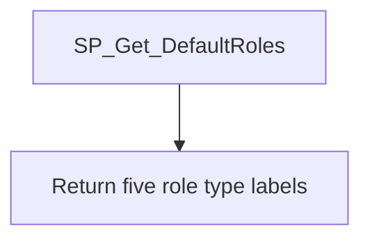

# SP_Get_DefaultRoles

## What it does

Returns five role-type labels as a single column RoleType. It does not read a table. The labels are RecruitmentAdmin, Administrator, HR, Employee, and Manager.

## Parameters

This procedure has no parameters.

## Call sequence

Calls no other procedures or functions.

## Callers

No other procedure or function calls this object.

## Nested

Calls no other procedures or functions.

## Steps

1. Union five constant SELECT values into one RoleType column.

## Tables

No table is read or written.

## Flow

