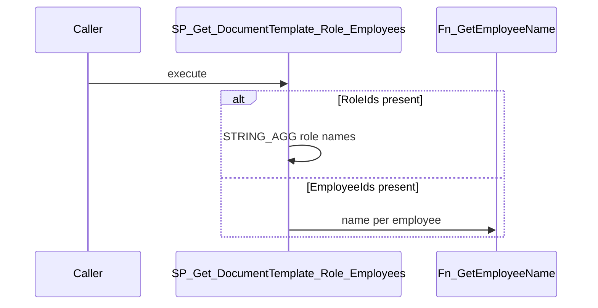
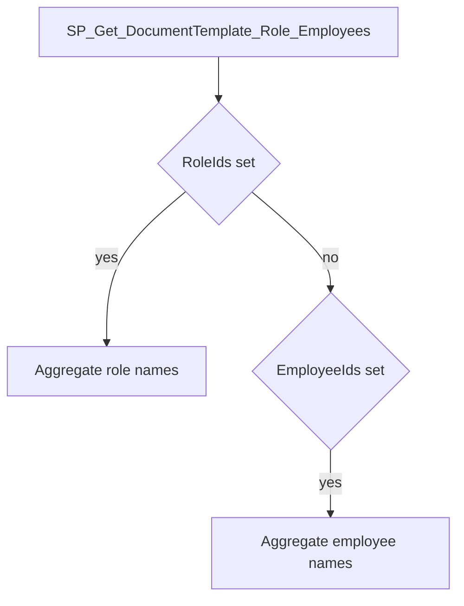

# SP_Get_DocumentTemplate_Role_Employees

## What it does

Expands a template's stored access lists into a single comma-separated display string. When `@RoleIds` is set, it aggregates role names. Otherwise, when `@EmployeeIds` is set, it aggregates active employee names with employment numbers. `@Documentid` is accepted but not used in the body.

## Parameters

| Name | Direction | What it is for |
|---|---|---|
| `@Documentid` | in | Document id (unused in the SELECT) |
| `@RoleIds` | in | Comma-separated role ids |
| `@EmployeeIds` | in | Comma-separated employee ids |

## Call sequence

## Callers

No other procedure or function calls this object. `DocBuilderDAL.GetDocumentTemplateRoleEmployees` executes it from `DocumentAccessCell.jsx`.

## Nested

| Object | Kind | When | Page |
|---|---|---|---|
| `Fn_GetEmployeeName` | function | employee-ids branch | [Fn_GetEmployeeName](/docs/database/hrms/Fn_GetEmployeeName) |

## Steps

1. When `@RoleIds` is not empty, aggregate `RoleName` from `tRoles` for the split ids.
2. Else when `@EmployeeIds` is not empty, aggregate active employee display names from `tEmployee` / `tEmployeeInfo`.

## Tables

| Table | Read or write |
|---|---|
| `dbo.tRoles` | read |
| `dbo.tEmployee` | read |
| `dbo.tEmployeeInfo` | read |

## Unresolved calls

None.

## Flow

