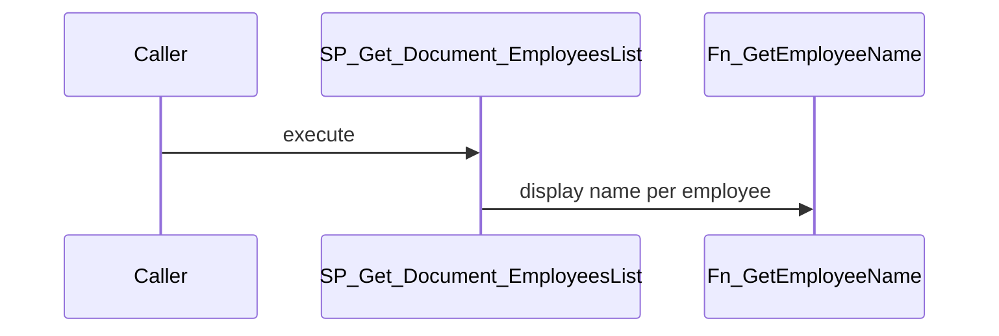
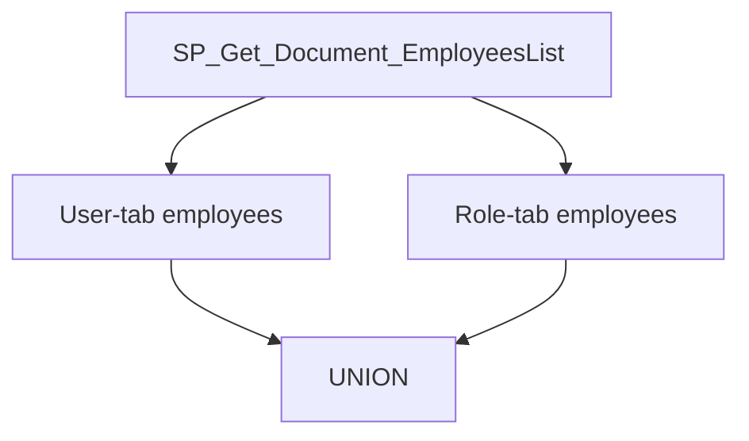

# SP_Get_Document_EmployeesList

## What it does

Lists active employees who can generate documents for a tab, either by direct user-tab assignment or by a role that has that tab. Names include employment number via `Fn_GetEmployeeName`. Doc Builder passes `TabId` 114.

## Parameters

| Name | Direction | What it is for |
|---|---|---|
| `@EmployerId` | in | Employer |
| `@TabId` | in | Tab whose employees are listed |

## Call sequence

## Callers

No other procedure or function calls this object. `DocBuilderDAL.GetAccessPermissionEmployee` executes it from Doc Builder.

## Nested

| Object | Kind | When | Page |
|---|---|---|---|
| `Fn_GetEmployeeName` | function | both UNION branches | [Fn_GetEmployeeName](/docs/database/hrms/Fn_GetEmployeeName) |

## Steps

1. Select employees linked through `tUserTabDetails` for the active tab and employer.
2. UNION employees linked through `tRoleTabDetails` → `tUsers` → `tUserEmployee` for the same tab and employer.
3. Return `EmployeeId` and formatted `EmployeeName`.

## Tables

| Table | Read or write |
|---|---|
| `dbo.tTabDetails` | read |
| `dbo.tUserTabDetails` | read |
| `dbo.tRoleTabDetails` | read |
| `dbo.tUserEmployee` | read |
| `dbo.tUsers` | read |
| `dbo.tEmployee` | read |
| `dbo.tEmployeeInfo` | read |

## Unresolved calls

None.

## Flow

