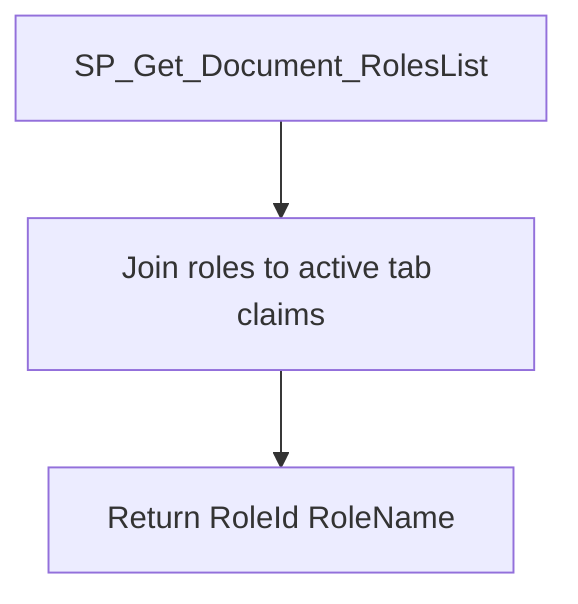

# SP_Get_Document_RolesList

## What it does

Lists roles that have an active tab claim for the given employer and tab. Doc Builder passes `TabId` 114 for generate-document access.

## Parameters

| Name | Direction | What it is for |
|---|---|---|
| `@EmployerId` | in | Employer |
| `@TabId` | in | Tab whose role claims are listed |

## Call sequence

Calls no other procedures or functions.

## Callers

No other procedure or function calls this object. `DocBuilderDAL.GetAccessPermissionRole` executes it from Doc Builder.

## Nested

Calls no other procedures or functions.

## Steps

1. Join `tRoles`, `tRoleTabDetails`, and active `tTabDetails` for `@TabId`.
2. Filter `tRoleTabDetails` to `@EmployerId` and return `RoleId` / `RoleName`.

## Tables

| Table | Read or write |
|---|---|
| `dbo.tRoles` | read |
| `dbo.tRoleTabDetails` | read |
| `dbo.tTabDetails` | read |

## Unresolved calls

None.

## Flow

