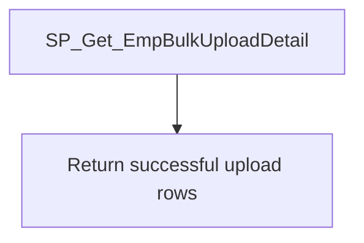

# SP_Get_EmpBulkUploadDetail

## What it does

Returns successful bulk-upload detail rows for one employee and category, newest upload first. The employee name is concatenated from Temployee.

## Parameters

| Name | Direction | What it is for |
|---|---|---|
| `@EmployeeId` | in | Employee |
| `@CategoryId` | in | Upload category |

## Call sequence

Calls no other procedures or functions.

## Callers

No other procedure or function calls this object.

## Nested

Calls no other procedures or functions.

## Steps

1. Join `TBulkUpload` to `TBulkUploadDetail` where status is S, employee and category match, and order by upload date descending (`SP_Get_EmpBulkUploadDetail.sql`).

## Tables

| Table | Read or write |
|---|---|
| `dbo.TBulkUpload` | read |
| `dbo.TBulkUploadDetail` | read |
| `dbo.Temployee` | read |

## Flow

