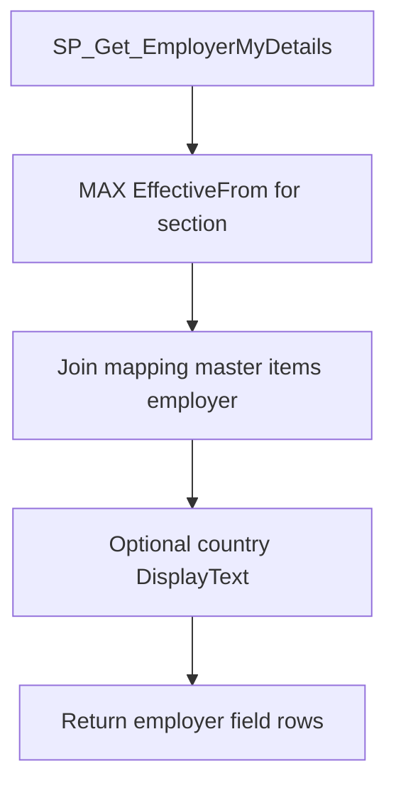

# SP_Get_EmployerMyDetails

## What it does

Returns employer-scoped My Details field rows for one section. It reads the latest `EffectiveFrom` on `POBLookupEmployerMapping` for that employer and section, then lists active mapping rows joined to master/items and organisation name, with optional `POBCandidateCountryFields` display-text override. Only `TCategoryID = 3` sections are included.

## Parameters

| Name | Direction | What it is for |
|---|---|---|
| `@POBLookupID` | in | Section to load |
| `@EmployerId` | in | Employer whose mapping rows are returned |

## Call sequence

Calls no other procedures or functions.

## Callers

No other procedure or function calls this object. Application caller: Core API `preOnBoardingDAL.GetLookupItemsByEmployer` for Field Config View/Edit.

## Nested

Calls no other procedures or functions.

## Steps

1. Script is `HRMS-DATABASE/HRMS/STOREPROCEDURE/SP_Get_EmployerMyDetails.sql`.
2. Compute `@EffectiveFrom` as `MAX(EffectiveFrom)` from `POBLookupEmployerMapping` for the employer and section.
3. Select organisation, section, item, mandatory/hide flags, and `@EffectiveFrom` from master/items/mapping joins to `TEmployerDetails`.
4. Left join `POBCandidateCountryFields` for display-text override.
5. Filter to `@POBLookupID`, `@EmployerId`, active mappings, and `TCategoryID = 3`.
6. Order by organisation name and `POBLookupID`.

## Tables

| Table | Read or write |
|---|---|
| `dbo.POBLookupEmployerMapping` | read |
| `dbo.POBLookupMaster` | read |
| `dbo.POBLookupItems` | read |
| `dbo.TEmployerDetails` | read |
| `dbo.POBCandidateCountryFields` | read |

## Flow

