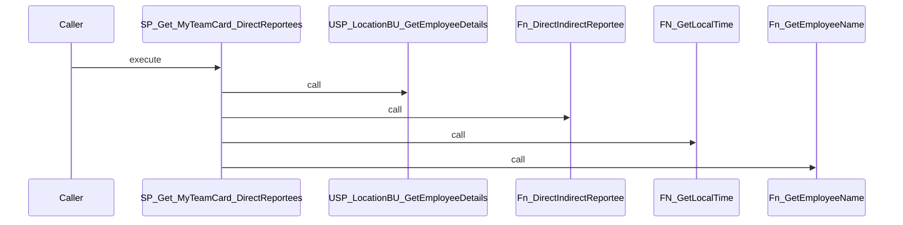
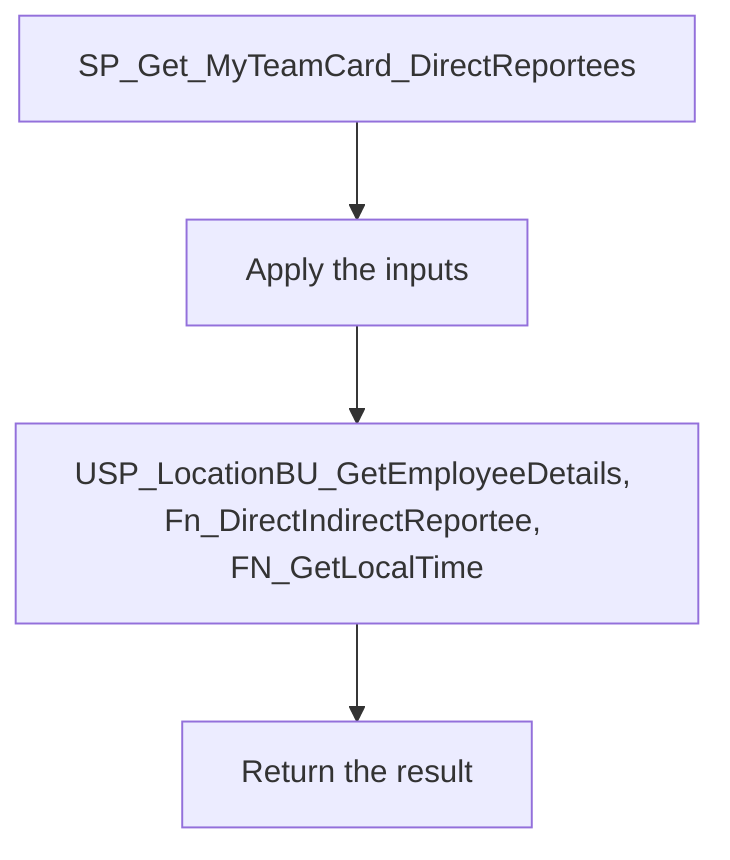

# SP_Get_MyTeamCard_DirectReportees

## What it does

Returns one page of the signed-in employee's direct reportees for the My Team card, after the location and business-unit visibility filter, with attendance and leave status for today.

## Parameters

| Name | Direction | What it is for |
|---|---|---|
| `@Employeeid` | in | Employee the Home screen is loading or acting for (`INT`) |
| `@Employerid` | in | Employer that owns the data (`INT`) |
| `@EmployeeName` | in | Optional name filter. Empty means do not filter by name (`VARCHAR(100)`) |
| `@PageNumber` | in | Page number for the list. Empty uses the procedure default (`INT`) |
| `@PageSize` | in | Page size for the list. Empty uses the procedure default (`INT`) |

## Call sequence

## Callers

No other procedure or function under STOREPROCEDURE or FUNCTIONS executes this object.

## Nested

| Object | Kind | When | Page |
|---|---|---|---|
| `USP_LocationBU_GetEmployeeDetails` | procedure | Called while this object runs | [USP_LocationBU_GetEmployeeDetails](/docs/database/hrms/USP_LocationBU_GetEmployeeDetails) |
| `Fn_DirectIndirectReportee` | function | Called while this object runs | [Fn_DirectIndirectReportee](/docs/database/hrms/Fn_DirectIndirectReportee) |
| `FN_GetLocalTime` | function | Called while this object runs | [FN_GetLocalTime](/docs/database/hrms/FN_GetLocalTime) |
| `Fn_GetEmployeeName` | function | Called while this object runs | [Fn_GetEmployeeName](/docs/database/hrms/Fn_GetEmployeeName) |

## Steps

In `HRMS-DATABASE/HRMS/STOREPROCEDURE/SP_Get_MyTeamCard_DirectReportees.sql`:

1. Returns one page of the signed-in employee's direct reportees for the My Team card, after the location and business-unit visibility filter, with attendance and leave status for today.

## Tables

| Table | Read or write |
|---|---|
| `TEmployee` | read |
| `TAttendanceTransaction` | read |
| `TLeaveRequestDays` | read |
| `TLeaveTypeMaster` | read |
| `TEmployeeInfo` | read |
| `TEmployerDetails` | read |
| `TOrgHierarchyDetails` | read |
| `TEmployeeContactDetails` | read |
| `TTitle` | read |
| `TLocation` | read |

## Flow

