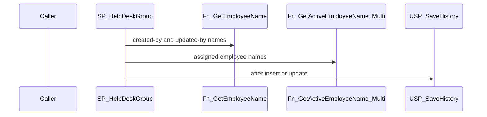
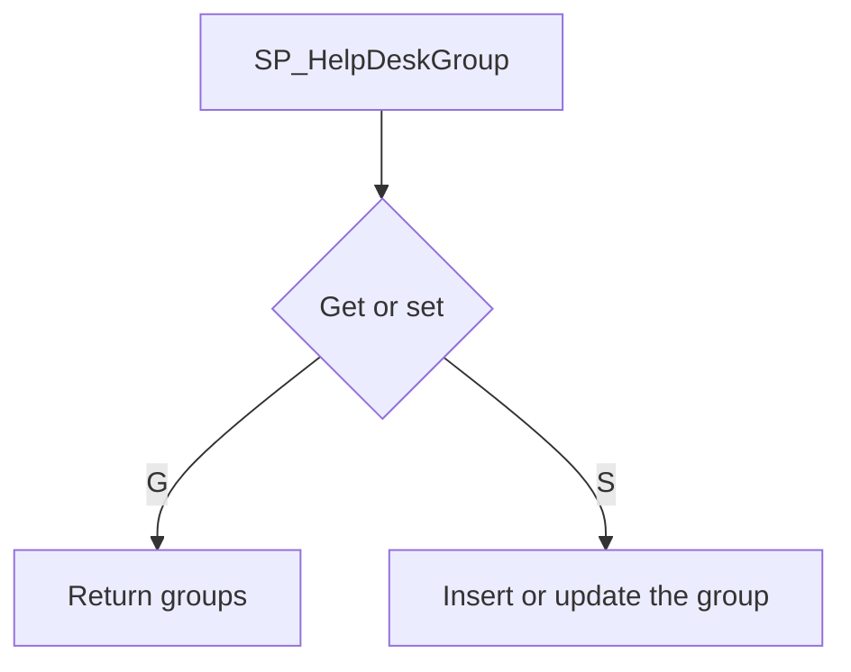

# SP_HelpDeskGroup

## What it does

Get returns help-desk groups and an open-ticket count. Set inserts or updates a group when the name is not already used for the employer, then records history.

## Parameters

| Name | Direction | What it is for |
|---|---|---|
| `@Flag_Get_Set` | in | G reads. S writes |
| `@EmployerID` | in | Employer |
| `@TransID` | in | Group to update. 0 inserts |
| `@GroupName` | in | Group name |
| `@AssignedTo` | in | Assigned employee ids |
| `@IsActive` | in | Y or N |
| `@UserID` | in | User stored as created by or updated by |
| `@Filter` | in | Y, N, or A. Defaults to A |
| `@EmailReminderFrequency` | in | Reminder frequency |

## Call sequence

## Callers

No other procedure or function calls this object.

## Nested

| Object | Kind | When | Page |
|---|---|---|---|
| `Fn_GetEmployeeName` | function | created-by and updated-by names | [Fn_GetEmployeeName](/docs/database/hrms/Fn_GetEmployeeName) |
| `Fn_GetActiveEmployeeName_Multi` | function | assigned employee names | [Fn_GetActiveEmployeeName_Multi](/docs/database/hrms/Fn_GetActiveEmployeeName_Multi) |
| `USP_SaveHistory` | procedure | after insert or update | No page yet |

## Steps

1. When the flag is G, select `THelpDeskGroup` and count open rows in `THelpDesk` (`SP_HelpDeskGroup.sql`).
2. When the flag is S and the group name already exists, return an error.
3. Otherwise insert or update the group and call `USP_SaveHistory`.

## Tables

| Table | Read or write |
|---|---|
| `dbo.THelpDeskGroup` | read and write |
| `dbo.THelpDesk` | read |
| `dbo.TEmployerDetails` | read |

## Flow

