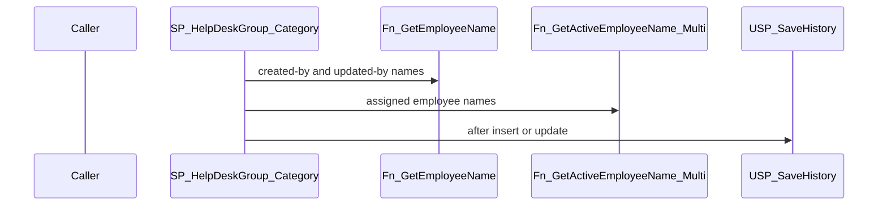
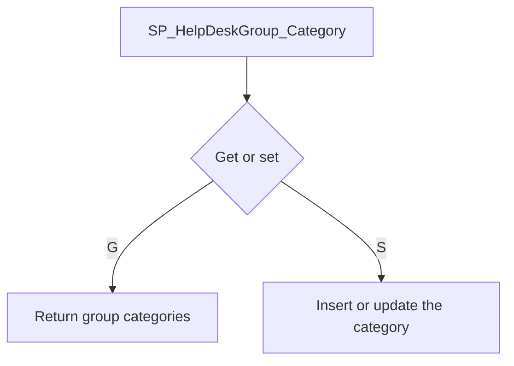

# SP_HelpDeskGroup_Category

## What it does

Get returns group categories with the group name and the category type name. Set refuses an inactive category type unless the row itself is being saved as inactive, refuses a duplicate, then inserts or updates THelpDeskGroup_Category and records history.

## Parameters

| Name | Direction | What it is for |
|---|---|---|
| `@Flag_Get_Set` | in | G reads. S writes |
| `@EmployerID` | in | Employer |
| `@TransID` | in | Category row to update. 0 inserts |
| `@GroupID` | in | Parent group |
| `@CategoryTypeId` | in | Category type |
| `@AssignedTo` | in | Assigned employee ids |
| `@IsActive` | in | Y or N |
| `@UserID` | in | User stored as created by or updated by |
| `@Filter` | in | Y, N, or A. Defaults to A |
| `@EmailReminderFrequency` | in | Reminder frequency |

## Call sequence

## Callers

No other procedure or function calls this object.

## Nested

| Object | Kind | When | Page |
|---|---|---|---|
| `Fn_GetEmployeeName` | function | created-by and updated-by names | [Fn_GetEmployeeName](/docs/database/hrms/Fn_GetEmployeeName) |
| `Fn_GetActiveEmployeeName_Multi` | function | assigned employee names | [Fn_GetActiveEmployeeName_Multi](/docs/database/hrms/Fn_GetActiveEmployeeName_Multi) |
| `USP_SaveHistory` | procedure | after insert or update | No page yet |

## Steps

1. When the flag is G, join `THelpDeskGroup_Category` to `THelpDeskGroup` and left join `TMHelpDeskCategoryType` (`SP_HelpDeskGroup_Category.sql`).
2. When the flag is S, reject an inactive category type unless `@IsActive` is N.
3. Reject a duplicate group and category, then insert or update and call `USP_SaveHistory`.

## Tables

| Table | Read or write |
|---|---|
| `dbo.THelpDeskGroup_Category` | read and write |
| `dbo.THelpDeskGroup` | read |
| `dbo.TMHelpDeskCategoryType` | read |
| `dbo.THelpDesk` | read |
| `dbo.TEmployerDetails` | read |

## Flow

