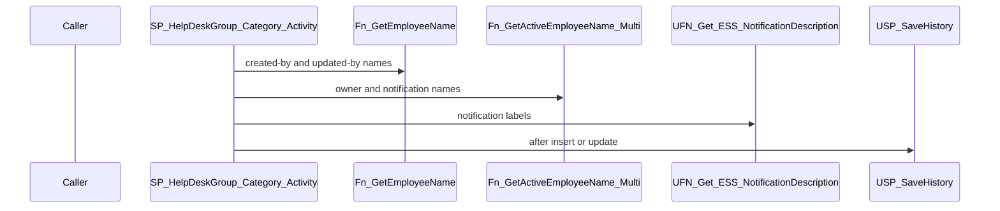
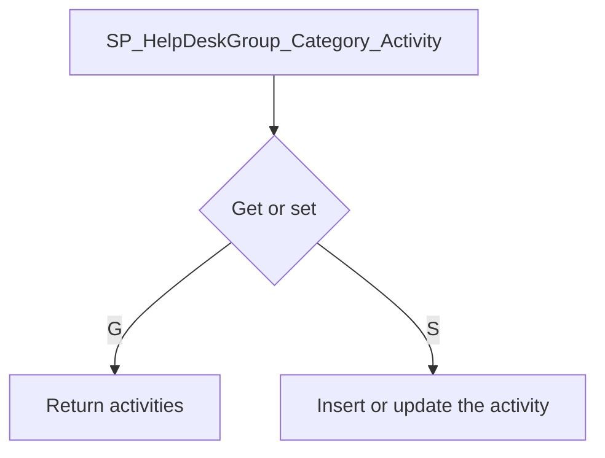

# SP_HelpDeskGroup_Category_Activity

## What it does

Get returns activities for a group category. Owner names follow the employer setting for whether owners sit on the group, the category, or the activity. Notification codes are turned into labels. Set inserts or updates an activity, including turnaround time, and records history. A duplicate activity name for the same group category is refused.

## Parameters

| Name | Direction | What it is for |
|---|---|---|
| `@Flag_Get_Set` | in | G reads. S writes |
| `@EmployerID` | in | Employer |
| `@TransID` | in | Activity to update. 0 inserts |
| `@Activity` | in | Activity name |
| `@GroupCategoryID` | in | Parent group category |
| `@AssignedTo` | in | Assigned employee ids |
| `@IsActive` | in | Y or N |
| `@UserID` | in | User stored as created by or updated by |
| `@Filter` | in | Y, N, or A. Defaults to A |
| `@ActivityTAT` | in | Turnaround unit |
| `@ActivityTATNumber` | in | Turnaround number |
| `@SendNotificationTo` | in | Notification codes |
| `@SendNotificationToEmployeeIds` | in | Employee ids for a selected-employee notification |
| `@EmailReminderFrequency` | in | Reminder frequency |
| `@UpdateFlag` | in | Which fields the update writes |

## Call sequence

## Callers

No other procedure or function calls this object.

## Nested

| Object | Kind | When | Page |
|---|---|---|---|
| `Fn_GetEmployeeName` | function | created-by and updated-by names | [Fn_GetEmployeeName](/docs/database/hrms/Fn_GetEmployeeName) |
| `Fn_GetActiveEmployeeName_Multi` | function | owner and notification names | [Fn_GetActiveEmployeeName_Multi](/docs/database/hrms/Fn_GetActiveEmployeeName_Multi) |
| `UFN_Get_ESS_NotificationDescription` | function | notification labels | [UFN_Get_ESS_NotificationDescription](/docs/database/hrms/UFN_Get_ESS_NotificationDescription) |
| `USP_SaveHistory` | procedure | after insert or update | No page yet |

## Steps

1. When the flag is G, join the activity to its category, group, and `tCustomerSettings` (`SP_HelpDeskGroup_Category_Activity.sql`).
2. Choose owner names from the group, category, or activity based on `MapHelpdeskActivityOwner`.
3. When the flag is S, refuse a duplicate activity, then insert or update and call `USP_SaveHistory`.

## Tables

| Table | Read or write |
|---|---|
| `dbo.THelpDeskGroup_Category_Activity` | read and write |
| `dbo.THelpDeskGroup_Category` | read |
| `dbo.THelpDeskGroup` | read |
| `dbo.TMHelpDeskCategoryType` | read |
| `dbo.tCustomerSettings` | read |
| `dbo.THelpDesk` | read |
| `dbo.TEmployerDetails` | read |

## Flow

