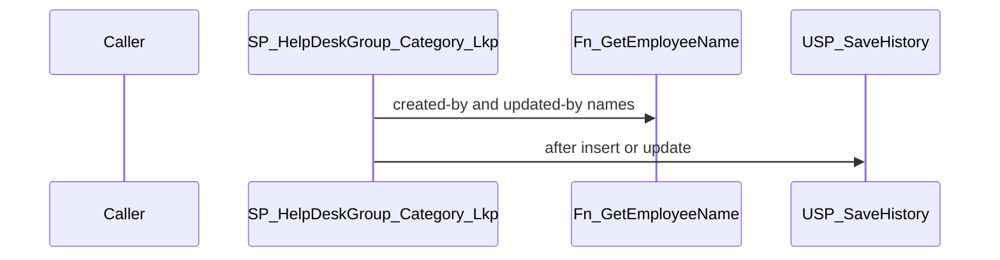
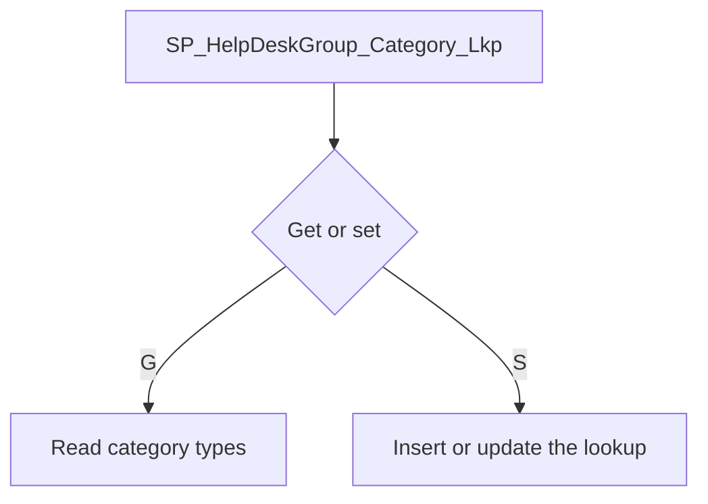

# SP_HelpDeskGroup_Category_Lkp

## What it does

Get returns help-desk category types from TMHelpDeskCategoryType. Set inserts or updates the employer lookup THelpDeskGroup_Category_Lkp and records history. A duplicate category name returns an error.

## Parameters

| Name | Direction | What it is for |
|---|---|---|
| `@Flag_Get_Set` | in | G reads. S writes |
| `@EmployerID` | in | Employer |
| `@TransID` | in | Lookup row to update. 0 inserts |
| `@Category` | in | Category name |
| `@IsActive` | in | Y or N |
| `@UserID` | in | User stored as created by or updated by |

## Call sequence

## Callers

No other procedure or function calls this object.

## Nested

| Object | Kind | When | Page |
|---|---|---|---|
| `Fn_GetEmployeeName` | function | created-by and updated-by names | [Fn_GetEmployeeName](/docs/database/hrms/Fn_GetEmployeeName) |
| `USP_SaveHistory` | procedure | after insert or update | No page yet |

## Steps

1. When the flag is G, select `TMHelpDeskCategoryType` for employer 0 or `@EmployerID` (`SP_HelpDeskGroup_Category_Lkp.sql`).
2. When the flag is S and the category name already exists, return an error.
3. Otherwise insert or update `THelpDeskGroup_Category_Lkp` and call `USP_SaveHistory`.

## Tables

| Table | Read or write |
|---|---|
| `dbo.TMHelpDeskCategoryType` | read |
| `dbo.THelpDeskGroup_Category_Lkp` | read and write |
| `dbo.TEmployerDetails` | read |

## Flow

