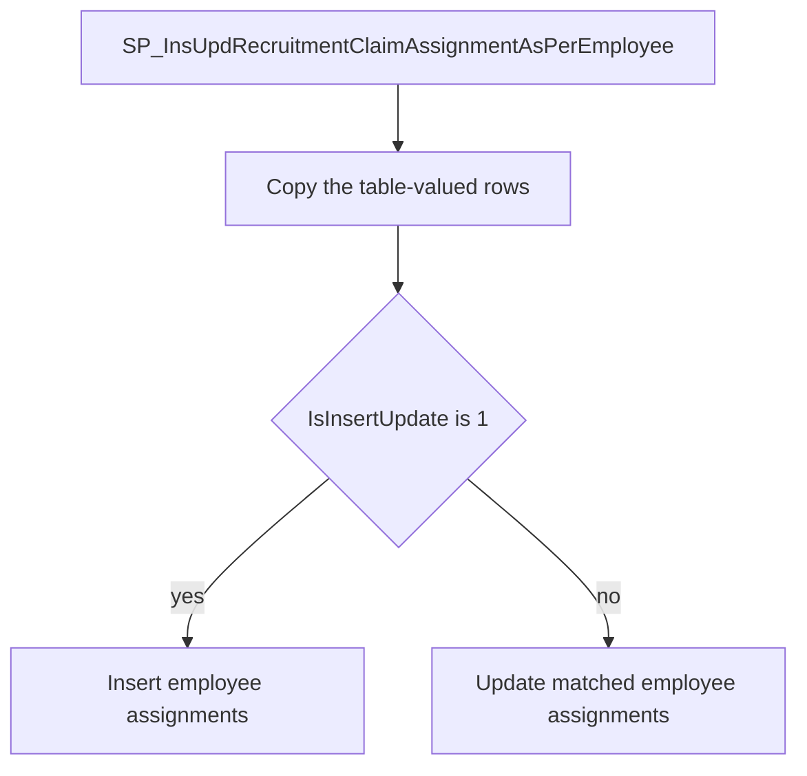

# SP_InsUpdRecruitmentClaimAssignmentAsPerEmployee

## What it does

Writes employee rows into `TRecruitmentClaim_ASSIGNMENT`, including `CustomBU`. `@IsInsertUpdate` 1 inserts the table-valued rows. Any other value updates rows matched on assignment id and does not insert leftovers.

## Parameters

| Name | Direction | What it is for |
|---|---|---|
| `@EmployerId` | in | Organisation |
| `@UDT_RecruitmentClaim_ASSIGNMENT` | in | `UDT_TRecruitmentClaim_ASSIGNMENT` |
| `@CreatedBy` | in | Actor |
| `@IsInsertUpdate` | in | 1 inserts. Other values update matched rows |

## Call sequence

Calls no other procedures or functions.

## Callers

No other procedure or function calls this object.

`recruitmentDAL.SaveUpdateRecruitmentDashboardsUsersPermissions` calls it from Recruitment Management. That method fills employee id and `CustomBU`, and leaves role id null.

## Nested

Calls no other procedures or functions.

## Steps

1. Copy assignment id, claim id, employee id, active flag, and `CustomBU` into `#RecruitmentClaim_ASSIGNMENT` (`SP_InsUpdRecruitmentClaimAssignmentAsPerEmployee.sql`).
2. When `@IsInsertUpdate` is 1, insert those columns into `TRecruitmentClaim_ASSIGNMENT`.
3. Otherwise update claim, active flag, employee, `CustomBU`, and audit columns where the assignment id and employer match.

## Tables

| Table | Read or write |
|---|---|
| `TRecruitmentClaim_ASSIGNMENT` | write |

## Flow

