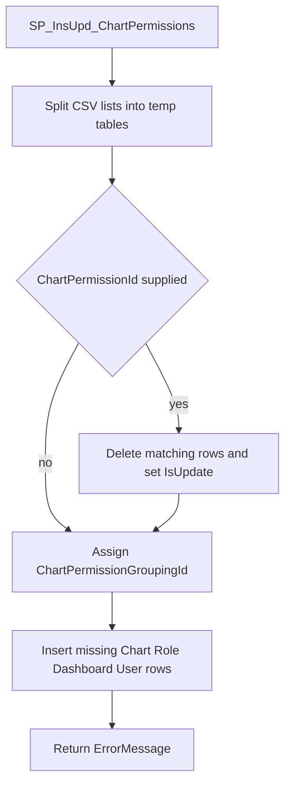

# SP_InsUpd_ChartPermissions

## What it does

Accepts a table-valued list of chart permission drafts, expands comma-separated chart, role, dashboard, and user ids, optionally deletes existing rows for the same employer/module when a `ChartPermissionId` list is supplied, then inserts every new Chart × Role × Dashboard × User combination that is not already present as a non-deleted row. Returns a one-column `ErrorMessage` result describing insert, update, or duplicate.

## Parameters

| Name | Direction | What it is for |
|---|---|---|
| `@udt_tChartPermissions` | in | TVP rows with `ChartPermissionId`, `EmployerId`, `ModuleId`, and CSV `ChartId`, `RoleId`, `DashboardId`, `UserId`, plus `IsGlobalAccess` |
| `@CreatedBy` | in | Employee id stored on each inserted row |

## Call sequence

Calls no other procedures or functions. Uses built-in `STRING_SPLIT` only.

## Callers

No other procedure or function calls this object. App caller: `dashBoardDAL.SaveUpdateSetupChartDetails` from Charts Setup (`SetupCharts.aspx`).

## Nested

Calls no other procedures or functions.

## Steps

In `HRMS-DATABASE/HRMS/STOREPROCEDURE/SP_InsUpd_ChartPermissions.sql`:

1. Split each TVP CSV column into temp tables for ChartId, RoleId, DashboardId (with `IsGlobalAccess`), and UserId. ChartPermissionId on those temp rows is set to null.
2. Read the first TVP row’s `ModuleId`, `EmployerId`, and `ChartPermissionId` CSV into locals.
3. When that `ChartPermissionId` CSV is non-empty and matching `TChartPermissions` rows exist for the module and employer, set `@IsUpdate = 1`, delete those ids, and bump `GroupingId` on the chart temp rows from the current max `ChartPermissionGroupingId`.
4. Always bump `GroupingId` again from the current max for the module and employer (defaulting to 1 when none exist).
5. Insert into `TChartPermissions` the cartesian product of the four temp tables for the same employer and module, left-joining existing non-deleted rows with the same ChartId, RoleId, and UserId, keeping only combinations where no such row exists. Columns written include `DashboardId`, `IsGlobalAccess`, `ChartPermissionGroupingId`, `CreatedBy`, and `CreatedDate`.
6. Return `SCOPE_IDENTITY()`-based success text for insert or update, or “Record with this combination already exists” when no identity was produced.

## Tables

| Table | Read or write |
|---|---|
| `dbo.TChartPermissions` | read, delete, write |

## Flow

