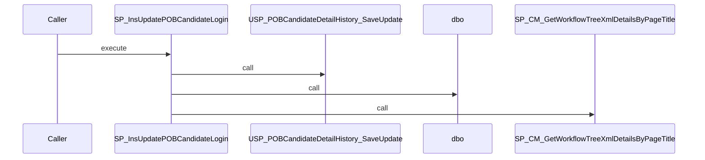
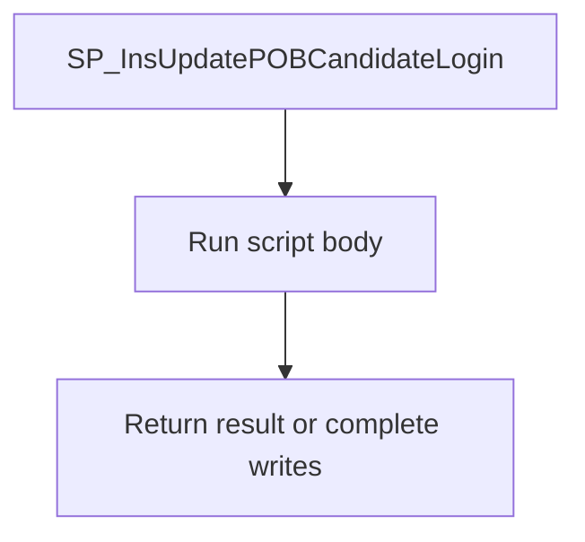

# SP_InsUpdatePOBCandidateLogin

## What it does

Inserts or updates POBCandidateLogin credentials and marks the candidate initiated.

## Parameters

| Name | Direction | What it is for |
|---|---|---|
| `@EmployerId` | in | INT |
| `@CandidateId` | in | INT |
| `@UserName` | in | VARCHAR |
| `@Password` | in | VARCHAR |
| `@SourceOfCandidate` | in | VARCHAR |
| `@LoginTypeID` | in | INT |
| `@LogInURL` | in | VARCHAR |
| `@TillValidDate` | in | DATETIME |
| `@ExpectedDateOfJoining` | in | DATETIME |
| `@LastLoginDate` | in | DATETIME |
| `@IsActive` | in | BIT |
| `@LoginUserID` | in | INT |
| `@IsInititaled` | in | BIT |
| `@Comment` | in | VARCHAR |

## Call sequence

## Callers

Application callers include Core API `preOnBoardingDAL` methods used by **Employee Management → Pre-Onboarding Candidate** (`PreOnboardCandidate.aspx`). Search HRMS `STOREPROCEDURE/` and `FUNCTIONS/` for additional `EXEC`/`dbo.` callers when extending this page.

## Nested

| Object | Kind | When | Page |
|---|---|---|---|
| `USP_POBCandidateDetailHistory_SaveUpdate` | procedure | always when reached | [USP_POBCandidateDetailHistory_SaveUpdate](/docs/database/hrms/USP_POBCandidateDetailHistory_SaveUpdate) |
| `dbo` | procedure | always when reached | No page yet |
| `SP_CM_GetWorkflowTreeXmlDetailsByPageTitle` | procedure | always when reached | [SP_CM_GetWorkflowTreeXmlDetailsByPageTitle](/docs/database/hrms/SP_CM_GetWorkflowTreeXmlDetailsByPageTitle) |

## Steps

From `HRMS-DATABASE/HRMS/STOREPROCEDURE/SP_InsUpdatePOBCandidateLogin.sql`:

1. Executes `USP_POBCandidateDetailHistory_SaveUpdate`.
2. Executes `dbo`.
3. Executes `SP_CM_GetWorkflowTreeXmlDetailsByPageTitle`.

## Tables

| Table | Read or write |
|---|---|
| `dbo.TJobSchedulerConfiguration` | read |
| `dbo.TEmployerDetails` | read |
| `dbo.POBCandidateLogin` | write |
| `dbo.POBCandidateLoginHistory` | write |
| `dbo.POBCandidate` | write |
| `dbo.TMAddCandidate` | write |
| `dbo.TRRSCandidateMapping` | read |
| `dbo.TRecruiter` | read |
| `dbo.TRRSCandidate` | write |
| `dbo.TEmailNotification` | write |

## Flow

