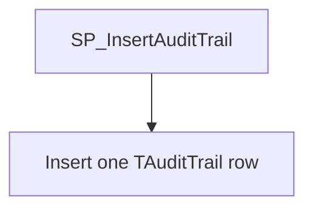

# SP_InsertAuditTrail

## What it does

Inserts one page-access row. Policy Documents Setup calls it on the first load of the page, with the session id, the page type name, the signed-in user name, and the selected employer. The script has no header comment. There is no existence check and no transaction inside the procedure. The DAL wraps the call in a `TransactionScope`.

## Parameters

| Name | Direction | What it is for |
|---|---|---|
| `@sessionID` | in | Session id, `varchar(50)`. |
| `@pageName` | in | Page name, `varchar(50)`. |
| `@userName` | in | User name, `varchar(100)`. |
| `@Employerid` | in | Employer stored on the row. |

## Call sequence

Calls no other procedures or functions.

## Callers

No other procedure or function calls this object. `DBHelper.AuditTrail` executes it. Policy Documents Setup calls that method on first load.

## Nested

Calls no other procedures or functions.

## Steps

1. In `HRMS-DATABASE/HRMS/STOREPROCEDURE/SP_InsertAuditTrail.sql`, insert one `TAuditTrail` row.
2. `AccessTime` is `SYSDATETIME()`. The other four columns are the parameters.
3. The procedure returns no result set.

`TAuditTrail.PageName` is `varchar(50)`, the same length as `@pageName`. The table script declares a primary key on `Id` and no foreign key.

## Tables

| Table | Read or write |
|---|---|
| `dbo.TAuditTrail` | write |

## Flow

