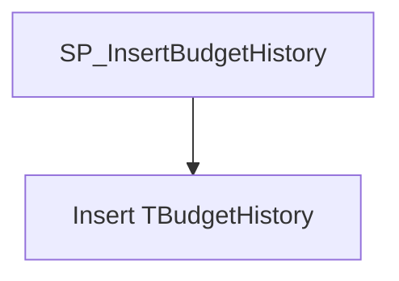

# SP_InsertBudgetHistory

## What it does

Inserts one `TBudgetHistory` row for an employer and budget, with a comment, actor, and action name.

## Parameters

| Name | Direction | What it is for |
|---|---|---|
| `@EmployerId` | in | Organisation |
| `@BudgetId` | in | Budget the action belongs to |
| `@Comments` | in | Comment text. Delete passes an empty string |
| `@CreatedBy` | in | Actor |
| `@ActionName` | in | Action label, such as `Deleted` |

## Call sequence

Calls no other procedures or functions.

## Callers

| Object | Kind | Page |
|---|---|---|
| `SP_DeleteBudget` | procedure | [SP_DeleteBudget](/docs/database/hrms/SP_DeleteBudget) |
| `SP_InsertUpdateTBudget` | procedure | No page yet |
| `SP_ApproveRejectBudgetApproval` | procedure | No page yet |

## Nested

Calls no other procedures or functions.

## Steps

1. Insert employer, budget, comments, actor, current time, and action name into `TBudgetHistory` (`SP_InsertBudgetHistory.sql`).

## Tables

| Table | Read or write |
|---|---|
| `TBudgetHistory` | write |

## Flow

