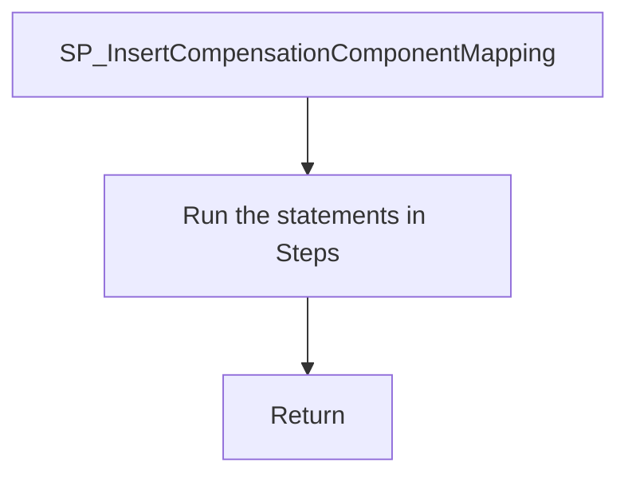

# SP_InsertCompensationComponentMapping

## What it does

Inserts one internal-to-external payroll component mapping row.

## Parameters

| Name | Direction | What it is for |
|---|---|---|
| `@EmployerId` | in | Employer |
| `@ComponentId` | in | Internal component id |
| `@ComponentName` | in | Internal name |
| `@ExternalComponentId` | in | External id optional |
| `@ExternalComponentName` | in | External name optional |
| `@ExternalComponentCode` | in | External code optional |
| `@IsMapped` | in | Mapped flag default 1 |
| `@CreatedBy` | in | Actor employee id |

## Call sequence

Calls no other procedures or functions.

## Callers

No other procedure or function calls this object.

## Nested

Calls no other procedures or functions.

## Steps

1. INSERT into tCompensationComponentMapping with CreatedDate = GETDATE().

## Tables

| Table | Read or write |
|---|---|
| `dbo.tCompensationComponentMapping` | write |

## Flow

