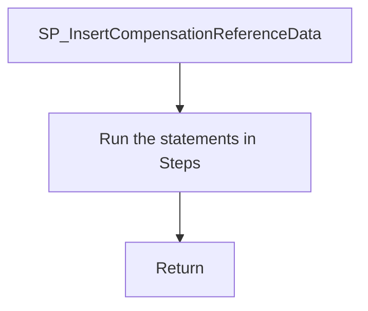

# SP_InsertCompensationReferenceData

## What it does

Inserts a trimmed compensation reference text/type row and returns the new ReferenceId.

## Parameters

| Name | Direction | What it is for |
|---|---|---|
| `@ReferenceText` | in | Display text |
| `@ReferenceType` | in | Reference type label |
| `@CreatedBy` | in | Actor employee id |
| `@EmployerId` | in | Employer scope |

## Call sequence

Calls no other procedures or functions.

## Callers

No other procedure or function calls this object.

## Nested

Calls no other procedures or functions.

## Steps

1. INSERT into TCompensationReferenceData with LTRIM/RTRIM on text and type.
2. SELECT SCOPE_IDENTITY() as NewReferenceId.

## Tables

| Table | Read or write |
|---|---|
| `dbo.TCompensationReferenceData` | write |

## Flow

