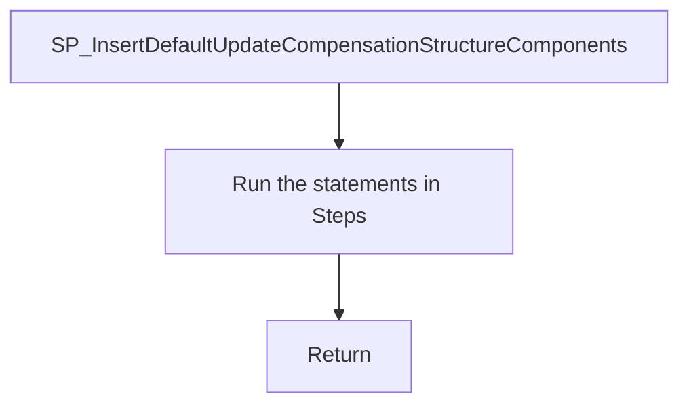

# SP_InsertDefaultUpdateCompensationStructureComponents

## What it does

Creates or updates a compensation structure and seeds earning components from TComponentsMaster (or copies from another structure). Used to bootstrap DefaultCompensationStructure.

## Parameters

| Name | Direction | What it is for |
|---|---|---|
| `@CompensationStructureId` | in | Null for insert |
| `@employerId` | in | Employer |
| `@employeeId` | in | Actor |
| `@CompensationStructureName` | in | Name |
| `@ComponentIds` | in | Extra component ids on update |
| `@IsCopy` | in | Copy from another structure |
| `@CopyFromCompensationStructureId` | in | Source structure when copying |
| `@Currency` | in | Currency id |

## Call sequence

Calls no other procedures or functions.

## Callers

| Object | Kind | Page |
|---|---|---|
| `SP_GetCompensationStructureByName` | procedure | [SP_GetCompensationStructureByName](/docs/database/hrms/SP_GetCompensationStructureByName) |

## Nested

Calls no other procedures or functions.

## Steps

1. If structure id is null, insert TCompensationStructure and capture identity.
2. On copy, clone TEarningSalaryComponents and TCustomFormulas from the source, remapping formula component ids.
3. On non-copy insert, seed components from TComponentsMaster and formulas from TCustomComponentFormulaMaster (falling back to employer 10 when none exist for the employer).
4. On update, append ComponentIds and update name/currency.

## Tables

| Table | Read or write |
|---|---|
| `dbo.TCompensationStructure` | write |
| `dbo.TEarningSalaryComponents` | write |
| `dbo.TCustomFormulas` | write |
| `dbo.TComponentsMaster` | read |
| `dbo.TCustomComponentFormulaMaster` | read |

## Flow

