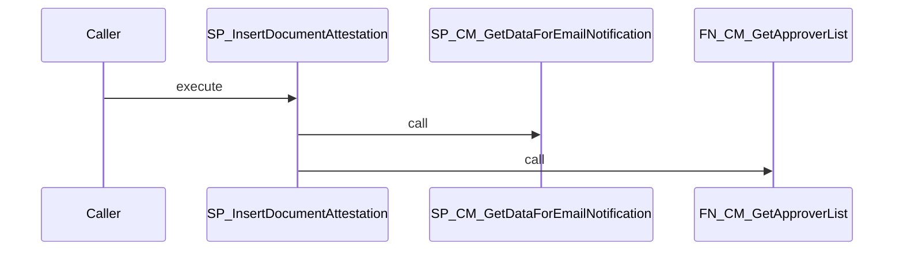
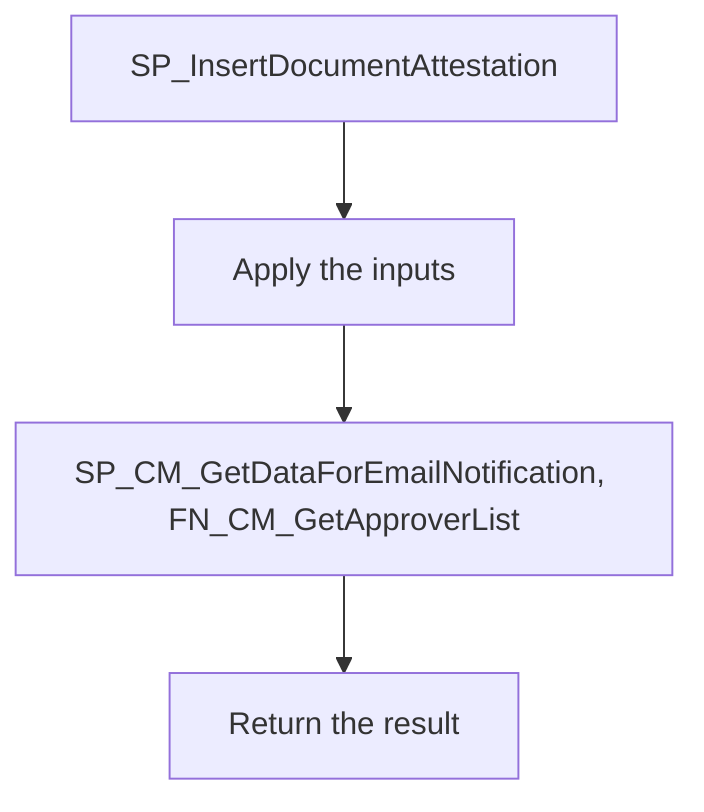

# SP_InsertDocumentAttestation

## What it does

Records the employee's policy sign-off for the document ids they attested, including the source of the sign-off.

## Parameters

| Name | Direction | What it is for |
|---|---|---|
| `@Employeeid` | in | Employee the Home screen is loading or acting for (`int`) |
| `@Documentids` | in | Comma-separated policy document ids being signed (`varchar(4000)`) |
| `@Employerid` | in | Employer that owns the data (`int`) |
| `@WorkflowId` | in | Workflow id sent with the sign-off. The banner sends 0 when it has none (`INT`) |
| `@SignOffSource` | in | Where the employee signed. The Home banner sends BANNER when the client does not set another source (`varchar(30)`) |

## Call sequence

## Callers

No other procedure or function under STOREPROCEDURE or FUNCTIONS executes this object.

## Nested

| Object | Kind | When | Page |
|---|---|---|---|
| `SP_CM_GetDataForEmailNotification` | procedure | Called while this object runs | [SP_CM_GetDataForEmailNotification](/docs/database/hrms/SP_CM_GetDataForEmailNotification) |
| `FN_CM_GetApproverList` | function | Called while this object runs | [FN_CM_GetApproverList](/docs/database/hrms/FN_CM_GetApproverList) |

## Steps

In `HRMS-DATABASE/HRMS/STOREPROCEDURE/SP_InsertDocumentAttestation.sql`:

1. Records the employee's policy sign-off for the document ids they attested, including the source of the sign-off.

## Tables

| Table | Read or write |
|---|---|
| `da` | write |
| `TDocumentAttestation` | read and write |
| `TEmailNotification` | write |
| `TWhatsAppNotification` | write |
| `Split` | read |
| `TPolicyDocument` | read |
| `DocumentIds` | read |
| `MSG` | read |

## Flow

