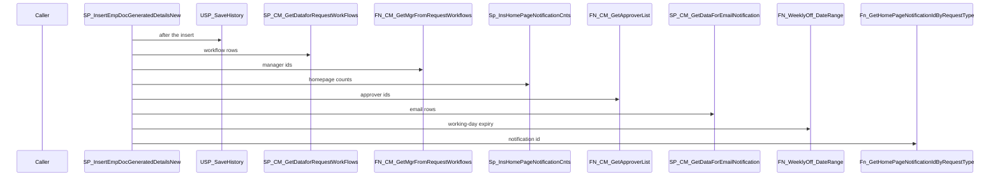
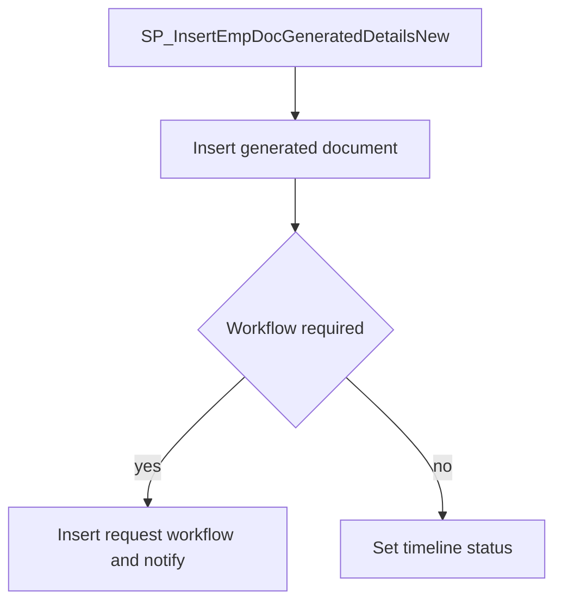

# SP_InsertEmpDocGeneratedDetailsNew

## What it does

Inserts a generated document with a null status, records history, inserts DocumentBuilderESS workflow rows, and queues homepage and email notifications. It then sets the status to Pending with Approver when the workflow has details, or Sent to Employee when the template needs acceptance or acknowledgement and no workflow details exist. Timeline dates are calculated only for Sent to Employee. The procedure returns the new id and then an error-message result set.

## Parameters

| Name | Direction | What it is for |
|---|---|---|
| `@DocumentTypeId` | in | Template id |
| `@EmployeeID` | in | Employee |
| `@GeneratedDocumentPath` | in | File path |
| `@CreatedBy` | in | Creator |
| `@EmployerID` | in | Employer |
| `@RequestType` | in | Request type stored with the workflow |
| `@WorkflowId` | in | Workflow id |
| `@DocumentMergedId` | in | Optional merged document id |

## Call sequence

## Callers

No other procedure or function calls this object.

## Nested

| Object | Kind | When | Page |
|---|---|---|---|
| `USP_SaveHistory` | procedure | after the insert | No page yet |
| `SP_CM_GetDataforRequestWorkFlows` | procedure | workflow rows | [SP_CM_GetDataforRequestWorkFlows](/docs/database/hrms/SP_CM_GetDataforRequestWorkFlows) |
| `FN_CM_GetMgrFromRequestWorkflows` | function | manager ids | [FN_CM_GetMgrFromRequestWorkflows](/docs/database/hrms/FN_CM_GetMgrFromRequestWorkflows) |
| `Sp_InsHomePageNotificationCnts` | procedure | homepage counts | [Sp_InsHomePageNotificationCnts](/docs/database/hrms/Sp_InsHomePageNotificationCnts) |
| `FN_CM_GetApproverList` | function | approver ids | [FN_CM_GetApproverList](/docs/database/hrms/FN_CM_GetApproverList) |
| `SP_CM_GetDataForEmailNotification` | procedure | email rows | [SP_CM_GetDataForEmailNotification](/docs/database/hrms/SP_CM_GetDataForEmailNotification) |
| `FN_WeeklyOff_DateRange` | function | working-day expiry | [FN_WeeklyOff_DateRange](/docs/database/hrms/FN_WeeklyOff_DateRange) |
| `Fn_GetHomePageNotificationIdByRequestType` | function | notification id | [Fn_GetHomePageNotificationIdByRequestType](/docs/database/hrms/Fn_GetHomePageNotificationIdByRequestType) |

## Steps

1. Look up the homepage notification id, insert `TEmployeeDocumentGeneratedDetails` with a null status, and call `USP_SaveHistory` (`SP_InsertEmpDocGeneratedDetailsNew.sql`).
2. Insert `TRequestWorkflows` from `SP_CM_GetDataforRequestWorkFlows`, then queue homepage counts and email rows.
3. When `tWorkFlowDetails` has rows for the workflow, set status to Pending with Approver. When it has none and the template needs acceptance or acknowledgement, set status to Sent to Employee.
4. For Sent to Employee with a timeline, calculate expiry and the next reminder. Working days use `FN_WeeklyOff_DateRange`.
5. Update the generated row, insert `TEmpDocGenerated_StatusDetails`, and return error code 0 with a success message.

## Tables

| Table | Read or write |
|---|---|
| `dbo.TEmployeeDocumentGeneratedDetails` | write |
| `dbo.TDocumentTemplates` | read |
| `dbo.TRequestWorkflows` | write |
| `dbo.TEmailNotification` | write |
| `dbo.TEmpDocGenerated_StatusDetails` | write |
| `dbo.tWorkFlowDetails` | read |
| `dbo.THomePageNotificationCnts` | write |

## Flow

