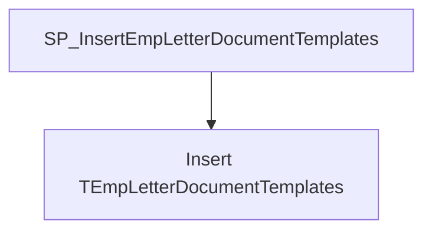

# SP_InsertEmpLetterDocumentTemplates

## What it does

Inserts one employee letter template into TEmpLetterDocumentTemplates, including acceptance, acknowledgement, timeline, reminder frequency, and category.

## Parameters

| Name | Direction | What it is for |
|---|---|---|
| `@DocumentName` | in | Name |
| `@DocumentDescription` | in | Description |
| `@TemplateModule` | in | Module text |
| `@DocumentType` | in | Template type |
| `@DocumentPath` | in | File path |
| `@DocumentFields` | in | Placeholder list |
| `@Createdby` | in | Creator |
| `@Employerid` | in | Employer |
| `@IsActive` | in | Y or N |
| `@ModuleId` | in | Module id |
| `@EmployeeAcceptance` | in | Y or N |
| `@EnableAcceptanceTimeline` | in | Timeline on or off |
| `@NoofDays` | in | Number of days |
| `@Timeline` | in | Working or calendar days |
| `@ReminderFrequency` | in | Reminder text |
| `@CategoryId` | in | Category ids |
| `@EnableAcknowledgement` | in | Acknowledgement on or off |

## Call sequence

Calls no other procedures or functions.

## Callers

No other procedure or function calls this object.

## Nested

Calls no other procedures or functions.

## Steps

1. Insert one row into `TEmpLetterDocumentTemplates` (`SP_InsertEmpLetterDocumentTemplates.sql`).

## Tables

| Table | Read or write |
|---|---|
| `dbo.TEmpLetterDocumentTemplates` | write |

## Flow

