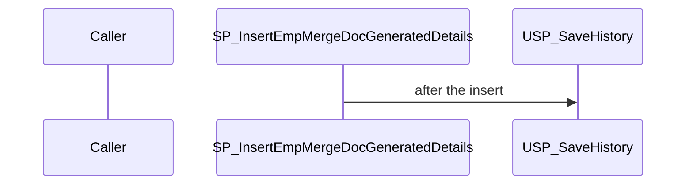
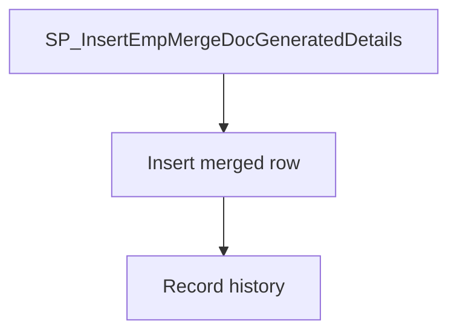

# SP_InsertEmpMergeDocGeneratedDetails

## What it does

Inserts a merged generated-document row and records history. The status is the value the caller passes. This screen passes Pending.

## Parameters

| Name | Direction | What it is for |
|---|---|---|
| `@DocumentTypeId` | in | Template id |
| `@EmployeeID` | in | Employee |
| `@GeneratedDocumentPath` | in | Merged file path |
| `@CreatedBy` | in | Creator |
| `@EmployerID` | in | Employer |
| `@RequestType` | in | Request type stored on the row |
| `@WorkflowId` | in | Workflow id |
| `@RetryCount` | in | Retry count |
| `@Status` | in | Status stored on the row |
| `@CategoryId` | in | Category |

## Call sequence

## Callers

No other procedure or function calls this object.

## Nested

| Object | Kind | When | Page |
|---|---|---|---|
| `USP_SaveHistory` | procedure | after the insert | No page yet |

## Steps

1. Insert `TEmployeeMergedDocumentGeneratedDetails` with the caller status (`SP_InsertEmpMergeDocGeneratedDetails.sql`).
2. Call `USP_SaveHistory` for the new row.

## Tables

| Table | Read or write |
|---|---|
| `dbo.TEmployeeMergedDocumentGeneratedDetails` | write |

## Flow

