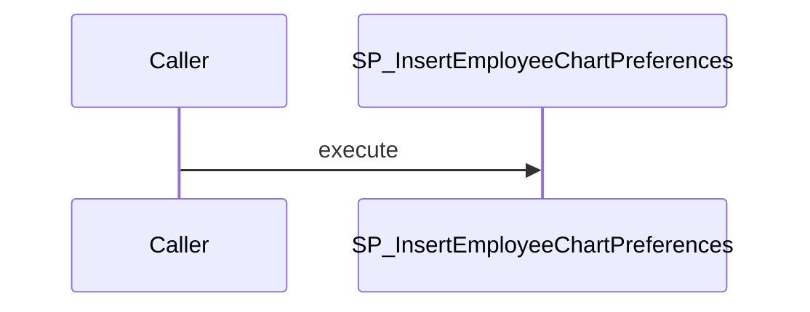
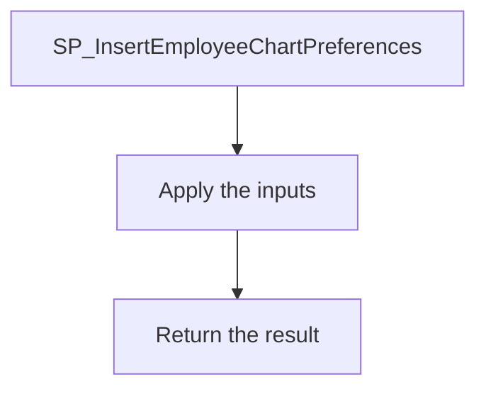

# SP_InsertEmployeeChartPreferences

## What it does

Saves the classic management-dashboard chart selection. A PreferenceIds value of 0 is stored as NULL so the employee falls back to the employer default.

## Parameters

| Name | Direction | What it is for |
|---|---|---|
| `@EmployeeId` | in | Employee the Home screen is loading or acting for (`int`) |
| `@EmployerId` | in | Employer that owns the data (`int`) |
| `@PreferenceIds` | in | Comma-separated preference ids to save. 0 clears the saved list (`varchar(1000)`) |

## Call sequence

## Callers

No other procedure or function under STOREPROCEDURE or FUNCTIONS executes this object.

## Nested

This object does not execute another procedure or user-defined function.

## Steps

In `HRMS-DATABASE/HRMS/STOREPROCEDURE/SP_InsertEmployeeChartPreferences.sql`:

1. Saves the classic management-dashboard chart selection.
2. A PreferenceIds value of 0 is stored as NULL so the employee falls back to the employer default.

## Tables

| Table | Read or write |
|---|---|
| `TEmployeeChartPreferences` | read and write |

## Flow

