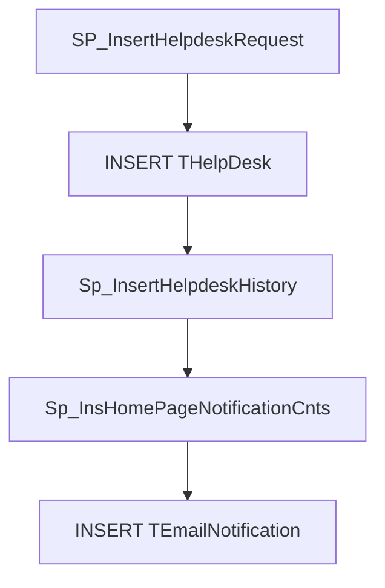

# SP_InsertHelpdeskRequest

## What it does

Creates a help-desk request row, rewrites support-document paths under the customer document root when files were uploaded, writes history, bumps home-page notification counts, and queues HelpdeskSubmitted emails and optional WhatsApp to activity owners.

## Parameters

| Name | Direction | What it is for |
|---|---|---|
| `@ActivityOwners` | in | Comma-separated owner employee ids |
| `@HD_GroupID / @HD_CategoryID / @HD_ActivityID` | in | Help-desk tree keys |
| `@SupportDocument` | in | Comma-separated file names |
| `@RequestDetails` | in | Request body |
| `@RequestStatus` | in | Usually Submitted |
| `@CreatedBy` | in | Submitting employee |
| `@EmployerId` | in | Employer |

## Call sequence

Calls nested procedures listed under Nested when present; otherwise runs inline SQL only.

## Callers

| Object | Kind |
|---|---|
| `HelpDeskDAL.AddHelpdeskRequest` | procedure |
| `ucHelpDeskRequest.ascx.cs` | application |

## Nested

- [`Sp_InsertHelpdeskHistory`](/docs/database/hrms/Sp_InsertHelpdeskHistory)
- [`Sp_InsHomePageNotificationCnts`](/docs/database/hrms/Sp_InsHomePageNotificationCnts)

## Steps

1. Resolve workflow id for HelpdeskSubmitted and category type name for notification id.
2. INSERT THelpDesk; optionally rebuild SupportDocument paths.
3. Exec Sp_InsertHelpdeskHistory with ActionType I.
4. Exec Sp_InsHomePageNotificationCnts for By Me.
5. INSERT TEmailNotification for each owner and creator; optional WhatsApp.

## Tables

| Table | Read or write |
|---|---|
| `THelpDesk` | write |
| `THelpDeskGroup_Category` | read |
| `THelpDeskGroup_Category_Activity` | read |
| `TWorkflowManagement` | read |
| `TDocumentPaths` | read |
| `TEmailNotification` | write |
| `TWhatsAppNotification` | write |

## Unresolved calls

None noted for this feature pass.

## Flow

