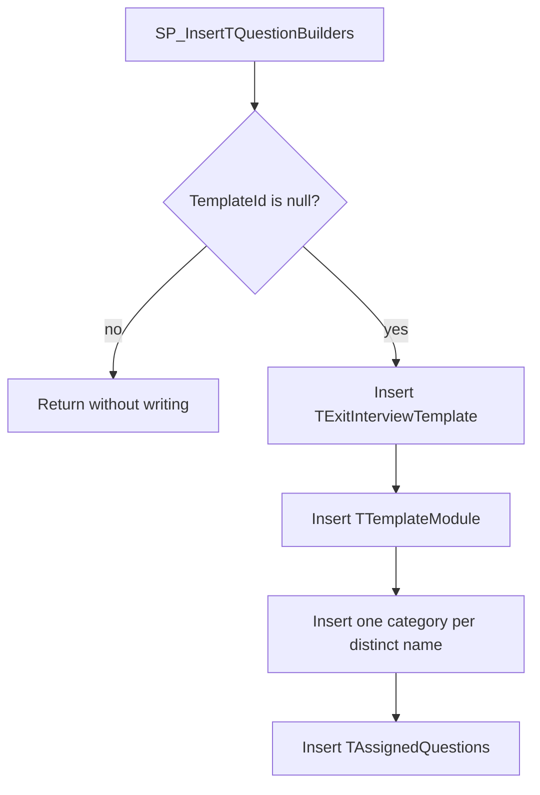

# SP_InsertTQuestionBuilders

## What it does

Creates an interview template when no template id was supplied. It inserts the header, maps it to one module, inserts one category row per distinct category name, and assigns every question in the table-valued parameter. When `@TemplateId` is already set, the procedure returns without writing.

## Parameters

| Name | Direction | What it is for |
|---|---|---|
| `@TemplateName` | in | Template name. Optional, default null |
| `@CreatedBy` | in | Employee who created the template |
| `@ModuleId` | in | Module the template is mapped to |
| `@EmployerId` | in | Organisation that owns the template |
| `@IsActive` | in | Active flag stored on the header, module, category, and assigned questions |
| `@UDT_QuestionCategory` | in | `UDT_TQuestionCategory` rows: category name, question id, category id, deleted flag |
| `@TemplateId` | in | Existing template id. Optional, default null. The insert runs only when this is null |
| `@TemplateModuleId` | in | Existing module-map id. Optional, default null. Replaced by the new identity when inserting |
| `@IsInterviewScoringEnabled` | in | Scoring flag stored on the header |
| `@CutoffScore` | in | Cutoff stored on the header |

## Call sequence

Calls no other procedures or functions.

## Callers

No other procedure or function calls this object. `recruitmentDAL.InsertQuestionBuilder` calls it inside a DAL transaction for `POST /api/recruitment/insertQuestionBuilder`.

## Nested

Calls no other procedures or functions.

## Steps

1. When `@TemplateId` is not null, skip the rest of the procedure (`SP_InsertTQuestionBuilders.sql`).
2. Insert `TExitInterviewTemplate` with the name, active flag, `GETDATE()`, creator, employer, scoring flag, and cutoff. Keep `SCOPE_IDENTITY()` as `@TemplateId`.
3. Insert `TTemplateModule` for that template, module, employer, active flag, and creator. Keep `SCOPE_IDENTITY()` as `@TemplateModuleId`.
4. Copy category name and question id from `@UDT_QuestionCategory` into `@All`. The copy does not include `IsDeleted`.
5. Insert `TTemplateModuleCategory` once per distinct category name, using the first row number for that name.
6. Set `@All.TemplateModuleCategoryId` from the new category rows that share the category name and `@TemplateModuleId`.
7. Insert `TAssignedQuestions` for every `@All` row, ordered by category id.

## Tables

| Table | Read or write |
|---|---|
| `TExitInterviewTemplate` | write |
| `TTemplateModule` | write |
| `TTemplateModuleCategory` | read and write |
| `TAssignedQuestions` | write |

## Flow

