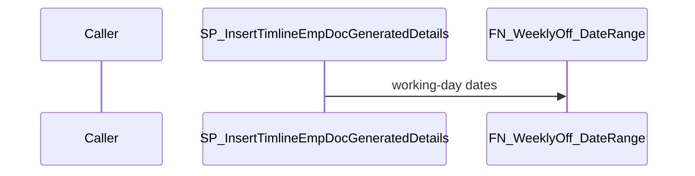
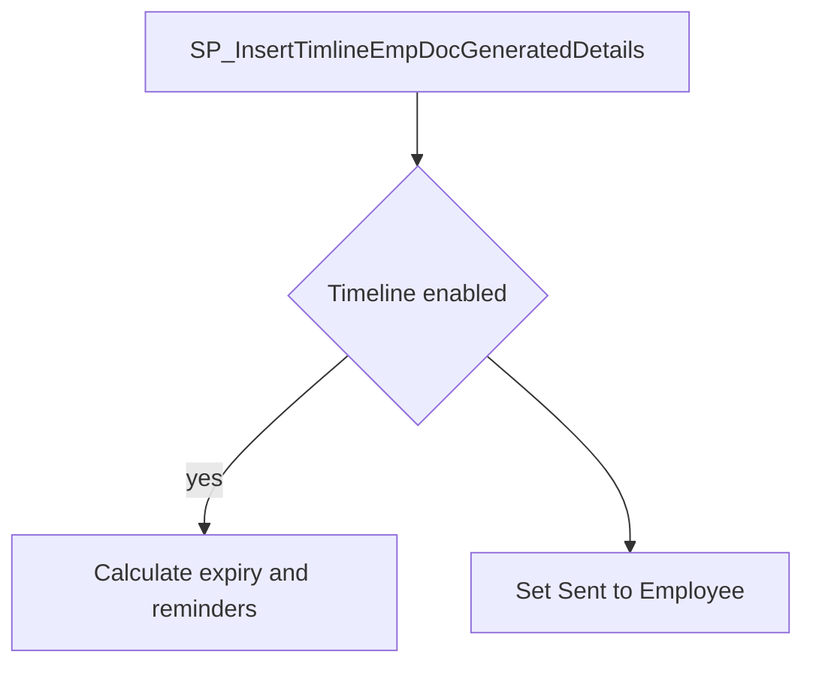

# SP_InsertTimlineEmpDocGeneratedDetails

## What it does

After initiate, sets a generated document to Sent to Employee and writes a status-detail row. When acceptance or acknowledgement uses a timeline, it calculates expiry and reminder dates. Working-day timelines skip weekly off through FN_WeeklyOff_DateRange.

## Parameters

| Name | Direction | What it is for |
|---|---|---|
| `@DocumentGenerationID` | in | Generated document |
| `@LoggedInUserId` | in | Employee who initiated |

## Call sequence

## Callers

No other procedure or function calls this object.

## Nested

| Object | Kind | When | Page |
|---|---|---|---|
| `FN_WeeklyOff_DateRange` | function | working-day dates | [FN_WeeklyOff_DateRange](/docs/database/hrms/FN_WeeklyOff_DateRange) |

## Steps

1. Read the generated row and its template (`SP_InsertTimlineEmpDocGeneratedDetails.sql`).
2. When acceptance or acknowledgement has a timeline, set expiry to one day past `NoofDays` and build reminder dates. Working days use `FN_WeeklyOff_DateRange`.
3. Update status to Sent to Employee and insert `TEmpDocGenerated_StatusDetails`.

## Tables

| Table | Read or write |
|---|---|
| `dbo.TEmployeeDocumentGeneratedDetails` | read and write |
| `dbo.TDocumentTemplates` | read |
| `dbo.TEmpDocGenerated_StatusDetails` | write |

## Flow

