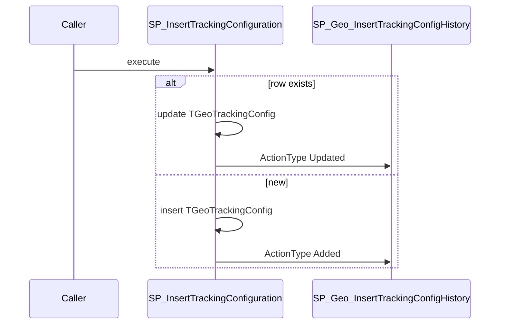
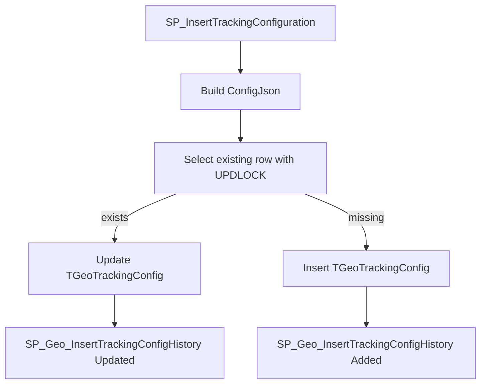

# SP_InsertTrackingConfiguration

## What it does

Upserts one employee's geo tracking configuration for an employer inside a transaction. If a row already exists for that employer/employee pair, it updates interval, distance, active flag, Auto/shift/custom times, and attendance-based mode, then writes an Updated history row. Otherwise it inserts a new `TGeoTrackingConfig` row and writes an Added history row. History always goes through `SP_Geo_InsertTrackingConfigHistory` with a JSON snapshot of the post-save display state.

## Parameters

| Name | Direction | What it is for |
|---|---|---|
| `@EmployerId` | in | Employer of the config |
| `@EmployeeId` | in | Employee being configured |
| `@Interval` | in | Tracking interval |
| `@Distance` | in | Distance filter (nullable) |
| `@IsActive` | in | Config enabled flag |
| `@TrackingIsAuto` | in | Auto vs Manual |
| `@TrackingOnShift` | in | As Per Shift vs Custom when Auto |
| `@startTime` | in | Custom window start |
| `@endTime` | in | Custom window end |
| `@IsAttendanceBasedTrackingEnabled` | in | As Per Attendance mode |
| `@ActionByEmployeeId` | in | Login user written on the history row |

## Call sequence

## Callers

No other procedure or function calls this object. `GeoTrackingDAL.InsertTrackingConfiguration` executes it once per selected employee.

## Nested

| Object | Kind | When | Page |
|---|---|---|---|
| `SP_Geo_InsertTrackingConfigHistory` | procedure | after update or insert | [SP_Geo_InsertTrackingConfigHistory](/docs/database/hrms/SP_Geo_InsertTrackingConfigHistory) |

## Steps

1. In `HRMS-DATABASE/HRMS/STOREPROCEDURE/SP_InsertTrackingConfiguration.sql`, set `NOCOUNT` and `XACT_ABORT ON`.
2. Build `@ConfigJson` (trackingMode, trackingType, times, employeeStatus, status) from the inbound parameters and `TEmployee.IsActive`.
3. Begin a transaction. Select the latest `TGeoTrackingConfig` row for employer/employee with `UPDLOCK, HOLDLOCK`.
4. If found: update columns, set `UpdatedOn` to UTC now, execute history with `@ActionType = 'Updated'` and prior scalar values.
5. If not found: insert a new row, capture `SCOPE_IDENTITY()`, execute history with `@ActionType = 'Added'`.
6. Commit. On error roll back and `THROW`.

## Tables

| Table | Read or write |
|---|---|
| `dbo.TGeoTrackingConfig` | read and write |
| `dbo.TEmployee` | read (employee status in JSON) |

## Flow

